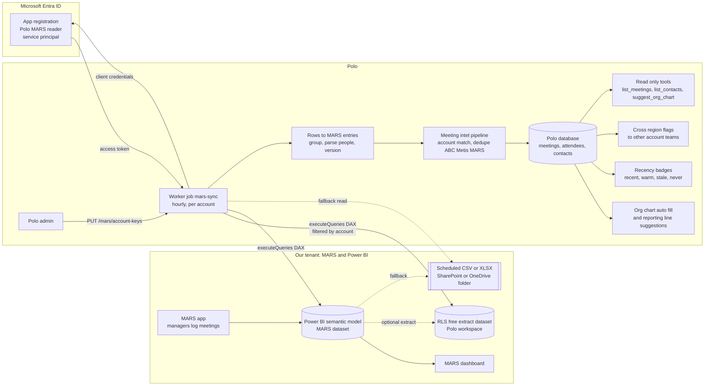
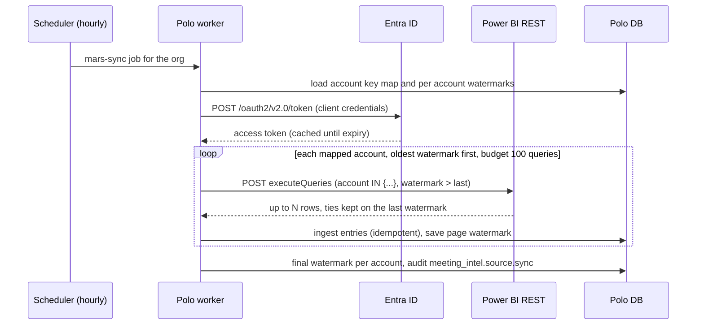
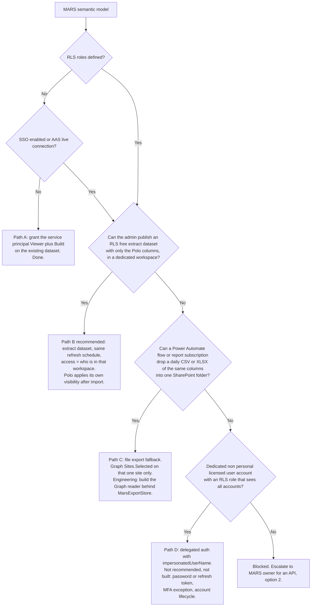

# Polo x MARS / Power BI integration playbook

Audience: MARS owner, Power BI and Entra admins (sections 1 to 9, 13), Polo engineers and on-call (all sections).
Status (2026-10-31, BRT): built and tested against mocks on branch `polo/mars-integration`, feature flag off, not merged, not deployed. No real MARS or Power BI system has been contacted. This playbook is the plan for the real rollout with the admins. No further UI or code is planned until the admins have answered section 13.

Contents

1. Purpose
2. Data flow
3. What Polo does with the data
4. Source options, ranked
5. Admin setup, step by step (Power BI primary path)
6. RLS decision tree
7. Required dataset schema and column mapping template
8. Sample DAX
9. Security and privacy
10. Sync behaviour
11. Go-live checklist and test plan
12. Rollback
13. Open questions
14. Ops runbook
15. Engineer pointers (code, commits, env vars, flags)
16. Glossary

---

## 1. Purpose

MARS is the internal tool where managers log, every week, which client people they met and when. Its data is shown on a main dashboard built on Power BI. For Polo, MARS is the source of truth for:

- who we met at each client account (name, title, email, company),
- when we met them, and who from our side was there,
- what was discussed (notes, when consent allows it).

Polo already holds accounts, opportunities, contacts, org charts and meetings from other sources (ABC, Metis). MARS fills the biggest gap: an account-by-account record of real client contact. Polo copies only what it needs, read-only, on a schedule, and applies its own access rules on top.

What this is not:

- Polo never writes back to MARS or Power BI.
- Polo does not replace the MARS dashboard. The dashboard stays the reporting tool; Polo uses the same data to enrich account views.
- No live dependency: if MARS or Power BI is down, Polo keeps showing what it already holds.

## 2. Data flow



Sequence of one sync run:



## 3. What Polo does with the data

| Feature | What MARS contributes | Rules |
| --- | --- | --- |
| Meeting history per account | One Polo meeting per MARS entry: date, our attendees, client people, notes | Lands in the existing meeting intel pipeline as source `mars`. Merged with ABC and Metis meetings of the same account, day and title, so nothing shows twice. |
| Contacts | Client people met, with title and email | Matched to existing Polo contacts by email, then exact name. Same person across sources: same email or LinkedIn handle; name alone only when it is unique in that company. Two "John Smith" stay apart. |
| Org chart | New people appear as suggested nodes (source `mars`); reporting lines are suggested from titles, function, seniority, shared meetings and any "reports to" field | Suggestions only. An admin accepts each one with the existing org chart move or seed actions (versioned, audited). Nothing overwrites the chart silently. |
| Recency | Last met date and meeting count per person and per org chart node | Badge: recent (0 to 30 days), warm (31 to 90), stale (over 90), never. |
| Cross-region flags | A MARS meeting at one subsidiary of a strategic group (tier key or top) notifies the account teams of the group's other subsidiaries | Recipients are the key account owner, director sponsor and open-deal owners of the sibling accounts, minus people already on this account. If a recipient may not see the account where the meeting happened, the text is redacted ("a colleague met X in another region"). |
| Agent tools | `list_meetings`, `list_contacts`, `suggest_org_chart` (read-only, MCP shaped) | Run under the caller's own Polo permissions; never with an org-wide key. |

Out of scope for v1: copying MARS LinkedIn URLs and manager hints onto the Contact record (they stay in the ingest payload and feed suggestions), removing a person from a Polo meeting when they are removed from a MARS entry (edits merge by union), and an admin UI for mapping (API only).

## 4. Source options, ranked

| Rank | Option | Pros | Cons | Status |
| --- | --- | --- | --- | --- |
| 1 | Power BI `executeQueries` on the MARS semantic model (or an RLS-free extract), service principal | No new system for MARS to build. Same numbers as the dashboard. Exact per-account DAX filter. Incremental by watermark. Read-only, least privilege (Viewer plus Build on one dataset). No user password. | Needs two tenant settings. Service principals are refused on datasets with RLS or SSO (see section 6). Freshness bound by the dataset refresh schedule. Hard limits: 100,000 rows or 1,000,000 values per query, 15 MB per response, 120 queries per minute per caller. Deletes are only visible if the dataset carries a flag or Polo does a full reconcile. | Built, mocked, tested. Recommended. |
| 2 | MARS REST API pull plus optional webhook nudge | Closest to the source, real time with webhook, tombstones and versions if MARS provides them. Polo still owns matching, dedupe and visibility. | MARS must expose a paginated "changed since" endpoint, auth and tombstones. Likely does not exist today. | Built against an assumed contract (mock). Use if MARS ever ships an API. |
| 3 | Scheduled CSV or XLSX export into one SharePoint or OneDrive folder (Power Automate flow or report subscription) | Works when executeQueries is refused. Admins control exactly which columns leave. Same column map as option 1. | Full snapshots, not incremental (Polo reads the newest file and diffs by content hash). File format drift breaks it. Needs Graph `Sites.Selected` on one site. Latency is the export schedule (daily typical). | Parser and logic built, store is mock only. Graph reader not built. |
| 4 | MCP layer | (a) MARS-side MCP: live answers, no copy. (b) Polo-side MCP: agents query what Polo already holds. | (a) Polo cannot dedupe or apply its own visibility to data it never stores, and every view would depend on MARS uptime. (b) Needs one of options 1 to 3 to feed it; it is a consumer, not a source. | (b) built as read-only tools under the user session. (a) not recommended. |

Recommendation: option 1 now; option 3 only if the admins refuse the tenant settings or the RLS route; option 2 if MARS gains an API; option 4b on top of whichever feeds the data.

## 5. Admin setup, step by step (Power BI primary path)

Roles needed: an Entra admin (Application Administrator or Cloud Application Administrator, plus Groups Administrator or owner rights to create a group) and a Fabric / Power BI administrator (for tenant settings) plus a workspace Admin (for access). Allow 15 to 30 minutes after tenant setting changes before testing.

Names below are the current Microsoft labels. Older labels are shown in brackets because tenants show either.

### Step 1. Entra ID: app registration

1. Entra admin center > Identity > Applications > App registrations > New registration.
2. Name: `Polo MARS reader`. Supported account types: "Accounts in this organizational directory only (Single tenant)". No redirect URI.
3. Certificates & secrets > Client secrets > New client secret. Expiry: 12 months maximum (put the renewal date in the calendar of the owner in section 14). A certificate is preferred if your policy allows it.
4. API permissions: do NOT add Power BI Service permissions and do NOT grant admin consent. For the service principal path, Power BI access comes only from the workspace role; Microsoft advises against Power BI API permissions on a service principal app.
5. Record: Directory (tenant) ID, Application (client) ID. Hand the secret to the Polo owner through the agreed secret store or vault share, never by email, chat or ticket.

Screenshots to capture:
- [ ] SCREENSHOT 5.1: app registration Overview page (tenant ID and client ID visible, secret NOT visible)
- [ ] SCREENSHOT 5.2: Certificates & secrets page showing the secret description and expiry date only
- [ ] SCREENSHOT 5.3: API permissions page showing no Power BI permissions

### Step 2. Entra ID: security group

1. Entra admin center > Groups > All groups > New group. Type: Security. Name: `SG Power BI API Polo MARS`. Membership: Assigned.
2. Members > Add members > search `Polo MARS reader` (the enterprise application / service principal) > Select.
3. Owners: the Polo owner and the Power BI admin.

Screenshots to capture:
- [ ] SCREENSHOT 5.4: group Overview (type Security)
- [ ] SCREENSHOT 5.5: group Members showing only the service principal

### Step 3. Power BI admin portal: allow service principals to use the APIs

1. app.powerbi.com > Settings (gear) > Admin portal > Tenant settings > Developer settings.
2. Setting: "Service principals can use Fabric APIs" (also labelled "Service principals can call Fabric public APIs"; older label "Allow service principals to use Power BI APIs").
3. Enabled. Apply to: Specific security groups > `SG Power BI API Polo MARS`. Apply.
4. Do not enable it for the entire organization for this project.

Screenshots to capture:
- [ ] SCREENSHOT 5.6: the setting expanded, Enabled, scoped to the security group

### Step 4. Power BI admin portal: allow executeQueries

1. Admin portal > Tenant settings > Integration settings.
2. Setting: "Semantic model Execute Queries REST API" (older label "Dataset Execute Queries REST API").
3. Enabled. If your tenant allows scoping, scope it to the same security group plus any existing users who need it.

Screenshots to capture:
- [ ] SCREENSHOT 5.7: the setting expanded and Enabled, with its scope

### Step 5. Decide the target dataset (RLS check)

Run the decision tree in section 6 first. It decides whether step 6 points at the existing MARS semantic model or at a new extract dataset in a dedicated workspace.

### Step 6. Workspace and dataset access

1. Open the workspace that holds the target dataset > Manage access > Add people or groups > `SG Power BI API Polo MARS` (or the service principal by name) > role Viewer.
2. On the dataset (semantic model) > More options > Manage permissions > grant Build to the same group. executeQueries needs Read plus Build.
3. Alternative if per-dataset Build cannot be granted: role Contributor on a dedicated extract workspace (includes Build). Do not use Member or Admin unless required by your policy; Polo needs no write rights.
4. Workspace must be a new (v2) workspace; "My workspace" is not supported for service principals.

Screenshots to capture:
- [ ] SCREENSHOT 5.8: workspace Manage access showing the group with role Viewer (or Contributor)
- [ ] SCREENSHOT 5.9: dataset Manage permissions showing Read and Build for the group

### Step 7. Send Polo the non-secret details

| Item | Value |
| --- | --- |
| Tenant ID | |
| Client ID | |
| Secret handed over via (name of vault / store, not the value) | |
| Secret expiry date | |
| Workspace name and ID (GUID from the URL `/groups/<id>/`) | |
| Dataset name and ID (GUID from the URL `/datasets/<id>/`) | |
| Storage mode (Import, DirectQuery, composite) | |
| Refresh schedule (times, time zone) | |
| Table name | |
| Column names | see the template in section 7 |

### Step 8. Smoke test with the admin (read-only)

Polo runs one query from the sandbox environment (section 11) that counts rows for one agreed account. The admin opens the dashboard filtered to the same account and date range and confirms the count. Any 401 or 403 at this step maps to a row in section 14.

Screenshots to capture:
- [ ] SCREENSHOT 5.10: dashboard filtered to the test account and date range, showing the row or meeting count

## 6. RLS decision tree

Microsoft: executeQueries with a service principal is NOT supported on a dataset with row-level security (RLS) or with SSO enabled, and not on Azure Analysis Services live connections. `impersonatedUserName` does not lift this for a service principal.



Also check object-level security (OLS): a hidden mapped column makes the query fail with a column error. Polo stops that account's run and reports the error code. Fix by removing the column from the map or granting access.

## 7. Required dataset schema and column mapping template

Shape Polo expects: one row per client person met in a meeting (preferred), or one row per meeting with the people in one cell separated by `;`, `|` or a line break (never a comma, because names contain commas). Rows with the same entry id are grouped into one meeting. Without an entry id, rows are grouped by account, meeting date and logging manager.

People cells may be `Name` or `Name <email>`. Dates may be datetime, date only, or an Excel serial; values without a time zone are read as UTC unless the admin says otherwise (question PBI 6).

Template for the admin to fill in. Required rows are marked. "Polo field" is the key used in the `MARS_PBI_COLUMNS` config.

| Polo field | Required | Meaning | Your table | Your column name | Data type | Example value | Notes |
| --- | --- | --- | --- | --- | --- | --- | --- |
| `account` | Yes | Client account value used for filtering (name, CRM id or code) | | | text | Northwind Energy | Must be stable over time. All spellings for one client go into the account key map. |
| `contactName` | Yes | Client person met | | | text | Jane Doe | |
| `meetingDate` | Yes | Meeting date or datetime | | | date or datetime | 2026-10-14 | Time zone? |
| `contactEmail` | Strongly recommended | Client person email | | | text | jane.doe@northwind.com | Main dedupe key |
| `contactTitle` | Recommended | Job title | | | text | CFO | Drives seniority and org chart suggestions |
| `company` | Recommended | Client legal entity or subsidiary | | | text | Northwind Energy UK Ltd | |
| `internalAttendee` | Recommended | Our people at the meeting | | | text or list | Ana Silva <ana@ourco.com> | Email strongly preferred |
| `notes` | Optional | Free text notes | | | text | | Follows Polo summary consent rules |
| `entryId` | Strongly recommended | Stable MARS entry id | | | text or number | 48213 | Without it, edits look like new meetings |
| `updatedAt` | Strongly recommended | Last modified datetime of the entry | | | datetime | 2026-10-15 09:12 | Best watermark; catches late edits |
| `loggedByEmail` | Optional | Manager who logged the entry | | | text | | |
| `loggedByName` | Optional | Same, name only | | | text | | |
| `topic` | Optional | Meeting subject | | | text | QBR | Becomes the Polo meeting title |
| `meetingType` | Optional | In person, call, video, event | | | text | In person | |
| `contactLinkedin` | Optional | LinkedIn URL | | | text | | Shown only to users with contacts:read |
| `contactDepartment` | Optional | Department | | | text | Finance | |
| `contactCountry` | Optional | Country of the client person | | | text | GB | Used for cross-region context |
| `contactReportsTo` | Optional | Manager of the client person | | | text | John Roe | Suggestions only |
| `accountDomain` | Optional | Client web domain | | | text | northwind.com | Helps account matching |
| `parentCompany` | Optional | Group or parent name | | | text | Northwind Group | Maps subsidiaries to the group |
| `confidential` | Optional | Restricted entry flag | | | boolean | false | Rows flagged true are refused by Polo. Better: exclude them at the source. |
| `deleted` | Optional | Soft delete flag | | | boolean | false | Lets Polo archive deleted entries |

Resulting config (example, placeholder names until the template comes back):

```json
{
  "table": "MARS Meetings",
  "columns": {
    "account": "Account",
    "contactName": "Contact Name",
    "contactEmail": "Contact Email",
    "contactTitle": "Contact Title",
    "company": "Company",
    "meetingDate": "Meeting Date",
    "internalAttendee": "Internal Attendee",
    "notes": "Notes",
    "entryId": "Entry ID",
    "updatedAt": "Modified At"
  }
}
```

Account key map (kept in Polo, not in env, edited by a Polo Admin):

| Polo account (company id and name) | MARS / Power BI account values (exact, 1 to 20 each) | Confirmed by | Date |
| --- | --- | --- | --- |
| `<uuid>` Northwind Energy | "Northwind Energy", "NWE-UK" | | |

Matching is whole value, trimmed, spaces collapsed, case-insensitive. Never substring or prefix: "Northwind Energy" never pulls "Northwind Energy Services". One value may belong to only one Polo account; a clash is refused. Up to 1,000 accounts per org.

## 8. Sample DAX

Polo builds the query; admins can paste these into DAX query view or DAX Studio to check names and counts. Replace table and column names with yours.

Row count for one account over a period (use for reconciliation):

```
EVALUATE
ROW(
  "rows", COUNTROWS(
    FILTER(
      'MARS Meetings',
      'MARS Meetings'[Account] IN { "Northwind Energy", "NWE-UK" }
        && 'MARS Meetings'[Meeting Date] >= DATE(2024, 11, 1)
    )
  ),
  "entries", DISTINCTCOUNT('MARS Meetings'[Entry ID])
)
```

The incremental page Polo sends (watermark on Modified At, 5000 row page):

```
DEFINE
  VAR __since = DATETIME(2026, 10, 1, 0, 0, 0)
EVALUATE
TOPN(
  5000,
  SELECTCOLUMNS(
    FILTER(
      'MARS Meetings',
      'MARS Meetings'[Account] IN { "Northwind Energy", "NWE-UK" }
        && 'MARS Meetings'[Modified At] > __since
    ),
    "mars_account", 'MARS Meetings'[Account],
    "mars_contactName", 'MARS Meetings'[Contact Name],
    "mars_contactEmail", 'MARS Meetings'[Contact Email],
    "mars_contactTitle", 'MARS Meetings'[Contact Title],
    "mars_company", 'MARS Meetings'[Company],
    "mars_meetingDate", 'MARS Meetings'[Meeting Date],
    "mars_internalAttendee", 'MARS Meetings'[Internal Attendee],
    "mars_notes", 'MARS Meetings'[Notes],
    "mars_entryId", 'MARS Meetings'[Entry ID],
    "mars_updatedAt", 'MARS Meetings'[Modified At]
  ),
  [mars_updatedAt], ASC
)
ORDER BY [mars_updatedAt] ASC
```

List the distinct account values (to build the key map with the admin):

```
EVALUATE
SUMMARIZECOLUMNS(
  'MARS Meetings'[Account],
  "rows", COUNTROWS('MARS Meetings'),
  "last_meeting", MAX('MARS Meetings'[Meeting Date])
)
ORDER BY 'MARS Meetings'[Account]
```

Notes for engineers:
- executeQueries has no bind parameters, so values are inserted as escaped literals: `"` doubled inside strings, `'` doubled in table names, `]` doubled in column names. Tests prove a hostile value cannot escape its literal.
- `TOPN` keeps all ties of the last row, so a page always ends on a complete watermark value; the next page asks for strictly later values.
- REST call: `POST https://api.powerbi.com/v1.0/myorg/groups/{workspaceId}/datasets/{datasetId}/executeQueries`, body `{"queries":[{"query":"..."}],"serializerSettings":{"includeNulls":true}}`. Token: `POST https://login.microsoftonline.com/{tenantId}/oauth2/v2.0/token`, `grant_type=client_credentials`, scope `https://analysis.windows.net/powerbi/api/.default`.

## 9. Security and privacy

Secrets
- Tenant ID, client ID and client secret come from environment variables populated from the secret store only. Never in code, git, tickets, chat or email. Never logged, never returned by any Polo route; the status route shows only "configured" or the error code.
- Secret rotation: at least every 12 months, or immediately on suspicion. Rotation = add a new secret in Entra, update the secret store, restart the worker, confirm a green sync, delete the old secret.

Least privilege
- Service principal in one security group, tenant settings scoped to that group only.
- Viewer plus Build on one dataset (or Contributor on one dedicated extract workspace). No Power BI API permissions on the app, no admin consent, no write rights anywhere.
- Fallback file path: Graph `Sites.Selected` on one SharePoint site, read-only grant, never `Sites.Read.All`.
- Columns: only the fields in section 7. An extract dataset is the cleanest way to guarantee nothing else leaves.

GDPR and retention (to confirm with the DPO, questions MARS 12 and 13)
- Data: client business contact data (name, business email, title, company), meeting dates, our employees' names and emails, optional notes.
- Lawful basis expected: legitimate interest (account management), same as for the data already in MARS. Record it in the processing register entry for Polo.
- Minimisation: confidential entries are refused and never stored. Unmatched entries keep only entry id, title, client name and candidate account ids, no attendee data. Transcripts are never requested.
- Retention: MARS meetings follow the existing Polo meeting intel retention. Deleted MARS entries (when the dataset exposes a `deleted` flag; a delete reconcile job is not built yet) archive the Polo meetings fed only by them. Retention period and erasure procedure for a data subject request must be confirmed by the DPO before go-live.
- Residency: Polo processes in its existing hosting region; confirm this is acceptable for MARS data.

Audit
- `meeting_intel.source.sync` per run, with counts (accounts, queries, rows pulled, stored, refused, unmatched, ambiguous, tombstoned, superseded).
- `meeting_intel.source.account_keys` on every change to the account key map (who, when, before and after).
- `meeting_intel.tool.<name>` per tool call (target account, returned count, PII flag, admin override).
- Power BI side: the admin can see the service principal's activity in the Power BI activity log (ExecuteQueries events).

Visibility rules in Polo (no new permissions)
- An account outside the caller's access scope answers `not_found`, never "forbidden", so existence does not leak.
- MARS meetings default to `account_team` visibility, like Metis.
- Reading meetings and contacts needs `meetings:read`; email and LinkedIn appear only with `contacts:read`.
- Org chart suggestions need `orgchart:read`; accepting one needs `orgchart:write`.
- Triggering a sync or editing the account key map needs `meetings:write` plus the Admin role.
- Cross-region notifications are redacted for recipients who may not see the meeting's account.

## 10. Sync behaviour

| Aspect | Behaviour | Setting |
| --- | --- | --- |
| Schedule | Hourly scheduled job per org, plus manual trigger by an Admin (`POST /api/v1/mars/sync`). Duplicate triggers in the same minute collapse. Minimum interval 15 minutes. | `MARS_SYNC_EVERY_MINUTES` (60) |
| Scope | One query per mapped Polo account, oldest watermark first. Nothing mapped means no query at all. | account key map |
| Watermark | `updatedAt` when mapped (recommended). Otherwise `meetingDate` with a 14 day lookback so late edits are picked up. The watermark never moves backwards. Saved after every page, so a crash resumes. | `MARS_PBI_WATERMARK`, `MARS_PBI_LOOKBACK_DAYS` |
| Backfill | A newly mapped account (or one whose key set changed) starts 730 days back (24 months) without replaying other accounts. | `MARS_PBI_BACKFILL_DAYS` (730) |
| Paging | Default 5000 rows per page, capped at half of what fits under 1,000,000 values for the mapped column count, minimum 50. If Power BI answers "more than N rows" (HTTP 200 with an error), the page halves and retries. | `MARS_PBI_PAGE_ROWS` |
| Throttling | 550 ms between requests (about 109 per minute, under the 120 per minute limit). HTTP 429: wait the `Retry-After` inline up to 30 s, otherwise stop and let the job retry later with the watermark kept. 5xx: exponential backoff, 3 retries. 401: one token refresh. | |
| Budget | At most 100 queries per run across accounts; the rest continues in a follow-up job. | `MARS_MAX_QUERIES_PER_RUN` (100) |
| Idempotency | Each entry version is stored once per (org, source, entry id and version). Version = modified-at epoch when mapped, else a content hash, so a re-read of unchanged data stores nothing and an edit becomes a new version. | |
| Edits | Same title and day merges into the existing meeting. A moved or retitled entry archives the older MARS-only meeting. | |
| Deletes | Archived when a `deleted` flag is mapped. Without a flag, an entry removed from the dataset is not detected: a reconcile job that diffs entry ids per account is not built yet (section 15, remaining work). Meetings also fed by ABC or Metis are never removed. | |
| Internal people | Matched to Polo users by email; a name-only colleague is matched only by an exact unique name, otherwise dropped (never filed as a client contact). | |

Expected load (to confirm with the row counts from question PBI 9): 200 accounts with a 5000-row page each fit in two hourly runs at under 2 queries per second.

## 11. Go-live checklist and test plan

### 11.1 Prerequisites

- [ ] Section 13 questions answered and recorded in this document.
- [ ] RLS path chosen (section 6) and the target dataset agreed.
- [ ] Steps 1 to 7 of section 5 done, screenshots 5.1 to 5.9 attached.
- [ ] Column template (section 7) filled in and reviewed with the admin.
- [ ] DPO sign-off on basis, retention, residency (section 9).
- [ ] Owners named in section 14.
- [ ] Branch `polo/mars-integration` merged after review, migrations applied, suites green.

### 11.2 Sandbox

1. Use a Polo staging org and, ideally, a copy of the dataset in a test workspace (or the extract dataset before it is shared widely).
2. Set the env vars (section 15) in staging only. `MARS_INTEGRATION_ENABLED=true` in staging, false in production.
3. Map 3 test accounts: one simple, one with several MARS spellings, one subsidiary of a strategic group (exercises cross-region flags).

### 11.3 Dry run

1. Trigger `POST /api/v1/mars/sync`. Read `GET /api/v1/mars/status`: source kind `powerbi`, mapped accounts 3, no `lastError`.
2. Check the audit entry `meeting_intel.source.sync` counts.
3. Review unmatched and ambiguous items: there should be none for mapped accounts.
4. Spot-check 10 meetings against the MARS dashboard: date, client people, our attendees, titles.
5. Check that a confidential test row is refused and appears nowhere.
6. Trigger the sync again: zero new items stored (idempotency).
7. Edit one entry in MARS, wait for the dataset refresh, sync: the meeting updates, no duplicate.

### 11.4 Reconciliation vs the Power BI report

For each test account and a fixed period (for example the last 90 days and the full 24 months):

| Account | Period | Power BI rows (DAX count) | Power BI distinct entries | Polo MARS meetings | Polo distinct client people | Difference | Explained by |
| --- | --- | --- | --- | --- | --- | --- | --- |
| | | | | | | | |

Accept when entries match exactly, or every difference is explained (refused confidential rows, merges with ABC or Metis meetings on the same day and title, rows outside the mapped key values). Unexplained difference over 1 percent blocks go-live.

### 11.5 Production rollout

1. Enable in production with the 3 test accounts mapped, observe 24 hours (24 runs).
2. Extend to 20 accounts, observe 48 hours: no 429 storms, run durations stable.
3. Map the remaining accounts in batches of 50; each batch backfills 24 months, expect a few follow-up runs.
4. Announce to account teams; point them at recency badges and org chart suggestions.
5. Repeat the reconciliation on 5 random accounts after one week.

## 12. Rollback

| Level | Action | Effect | Data |
| --- | --- | --- | --- |
| Pause | Set `MARS_INTEGRATION_ENABLED=false`, restart API and worker | `/mars/*` routes answer 404, schedule not registered, job returns `disabled` | All imported data stays, badges just age |
| Stop one account | Remove it from the account key map (`PUT /mars/account-keys`) | No more queries for it; its watermark is dropped | Existing meetings stay |
| Cut access at the source | Power BI admin removes the group from the workspace, or disables the tenant settings for the group; Entra admin deletes the secret | Next run fails with 401 or 403, recorded on the connection | Polo keeps what it has |
| Remove imported data | Engineering task: archive meetings whose only source link is `mars` for the org (same path as tombstones), reject pending org chart suggestions of source `mars` | MARS-only meetings disappear from views; meetings also fed by ABC or Metis stay | Follow the retention procedure; record in audit |
| Code rollback | Revert the merge of `polo/mars-integration`. The migration is additive (enum value, two nullable columns); leave it in place | No MARS code paths | None |

## 13. Open questions

### For the MARS owner

1. Who owns MARS data (business owner) and who approves it leaving MARS into Polo?
2. Is there a MARS API today (REST, GraphQL, database view)? If yes: base URL, sandbox, auth, rate limits.
3. How is a client account identified in MARS: free text, a pick list, a CRM id, a code? Can one client appear under several values?
4. Is there a stable entry id and a last-modified timestamp?
5. Are deleted entries removed from the data, or flagged?
6. One row per person met, or one row per meeting with people in a list?
7. Are our internal attendees captured by corporate email or by name only?
8. Is there a confidential or restricted flag? Which entries must never leave MARS?
9. Is "reports to" or a department ever captured for client people?
10. One MARS tenant for the whole group, or per region or legal entity?
11. How much history should the first backfill take? (Default: 24 months.)
12. Lawful basis and retention for client contact data; is DPO sign-off needed?
13. Data residency constraints?
14. Who is the MARS on-call contact, and where should Polo report data issues?

### For the Power BI admin

1. Workspace and dataset (semantic model) names and IDs behind the MARS dashboard? Import, DirectQuery or composite?
2. Does the dataset use RLS, OLS or SSO? If yes, can you publish an RLS-free extract dataset for Polo in its own workspace?
3. Can "Service principals can use Fabric APIs" and "Semantic model Execute Queries REST API" be enabled for one security group?
4. Table name and column names (fill the template in section 7).
5. Is there a stable entry id and a last-modified column?
6. Time zone of the date and datetime columns?
7. Refresh schedule, current row count, growth per week?
8. Is the workspace on shared or Premium / Fabric capacity? Any capacity throttling we should respect?
9. Secret or certificate policy (maximum lifetime, who rotates)?
10. If executeQueries is refused: can a Power Automate flow or report subscription drop a daily CSV or XLSX of the same columns into one SharePoint folder that Polo may read with `Sites.Selected`?

Answers log:

| # | Question | Answer | Who | Date |
| --- | --- | --- | --- | --- |
| | | | | |

## 14. Ops runbook

### 14.1 Who owns what

| Area | Owner (to fill) | Backup |
| --- | --- | --- |
| MARS data quality and entry rules | MARS owner | |
| Power BI dataset, refresh, workspace access | Power BI admin | |
| Entra app, secret rotation | Entra admin | |
| Secret store entry and env config | Polo platform owner | |
| Polo sync job, alerts, fixes | Polo engineering on-call | |
| Account key map, unmatched items, org chart suggestions | Polo Admin (sales ops) | |
| GDPR, retention, data subject requests | DPO | |

### 14.2 Where to look

- `GET /api/v1/mars/status`: configured or not, source kind, mapped accounts, last sync time, last error code, counts.
- Audit log: `meeting_intel.source.sync`, `meeting_intel.source.account_keys`.
- Worker logs for job `mars-sync` (no secrets or row contents are logged).
- Power BI activity log for the service principal (admin side).

### 14.3 Errors and fixes

| Symptom or error code | Likely cause | Fix | Who |
| --- | --- | --- | --- |
| `not_configured` | Env var missing or invalid (tenant, client, workspace or dataset id not a GUID, column map invalid JSON or missing required columns) | Check env names in section 15; the status route says which | Polo platform |
| Token request 400 or 401 (`invalid_client`) | Wrong client ID or secret, secret expired | Rotate secret (section 9), update store, restart worker | Entra admin + Polo platform |
| executeQueries 401 after refresh | Service principal not allowed by tenant setting, or change not yet applied | Check step 3 scope; wait 30 minutes | Power BI admin |
| executeQueries 403 or 404 | Group not on the workspace, missing Build, wrong workspace or dataset ID | Check step 6; check IDs | Power BI admin |
| `PowerBiQueryError` mentioning RLS or "not supported for service principal" | Dataset has RLS or SSO | Section 6, path B | Power BI admin |
| `PowerBiQueryError` column or table not found | Column renamed, OLS, map out of date | Update `MARS_PBI_COLUMNS`, restart | Polo platform with admin |
| Repeated 429, `MarsRateLimitedError` | Other callers on the same identity or capacity throttling | Nothing urgent, the job retries; if persistent lower `MARS_MAX_QUERIES_PER_RUN` or raise `MARS_SYNC_EVERY_MINUTES` | Polo on-call |
| Row cap errors every run | Very wide rows | Lower `MARS_PBI_PAGE_ROWS`, drop unused columns from the map | Polo on-call |
| 5xx after 3 retries | Power BI incident | Check Microsoft service health; job retries next hour | Polo on-call |
| Data stale but no error | Dataset refresh failing on the Power BI side | Check refresh history | Power BI admin |
| Many unmatched or ambiguous items | Key map incomplete, new account spellings | Run the distinct accounts DAX, update the key map | Polo Admin |
| Duplicate people | Missing emails in MARS | Ask MARS owner to capture emails; merge in Polo | MARS owner |
| Missing meetings vs dashboard | Confidential rows refused, key value missing, watermark on meeting date without lookback | Reconcile (11.4); check lookback | Polo on-call |
| Meetings in Polo that are gone from the dashboard | Entry deleted in MARS, no `deleted` column mapped | Ask for a `deleted` flag, or build the reconcile job | Polo engineering |

### 14.4 Alerts (to wire at go-live)

- Sync error on 3 consecutive runs for the org: page the Polo on-call.
- No successful sync for 6 hours with the flag on: warn the Polo on-call.
- Unmatched items over 20 in a day: notify the Polo Admin.
- Secret expiry within 30 days: notify the Entra admin and Polo platform owner (calendar reminder until automated).
- Rows pulled per day drop by more than 80 percent vs the 7 day average: warn the Polo on-call and the Power BI admin (likely refresh failure).

### 14.5 Routine tasks

- Weekly: review unmatched items and pending org chart suggestions (Polo Admin).
- Monthly: reconciliation on 5 random accounts (Polo on-call).
- Yearly or before expiry: secret rotation (Entra admin, Polo platform).
- On request: re-import one account from scratch (24 month backfill) by changing its key set in the account key map, which resets its watermark. This refreshes edits but does not remove deleted entries until the reconcile job exists.

## 15. Engineer pointers

Branch `polo/mars-integration`, worktree `/workspace/polo-mars`, based on `polo/backend-hardening` @ 5460f17f. Local commits only, not pushed.

| Commit | Content |
| --- | --- |
| `3e28161d` | MARS adapter, sync job, tools (flag off) |
| `a97e33c9` | Shared, worker and API tests; dedupe and inference fixes |
| `19a5f565` | Flag gate after RBAC (route census) |
| `36eda509` | Account key map, per-account cursors, tabular column map (shared schema, `settings` column) |
| `84566542` | Power BI primary source per account, SharePoint/OneDrive export fallback (mock), account-keys API |
| (this doc) | `docs/integrations/mars.md` |

Files

| Area | File |
| --- | --- |
| Contract, matcher, key normalisation, key map, column map, dedupe, recency, inference, tool schemas | `packages/shared/src/schemas/mars.ts` |
| DB: `mars` source, `sync_cursor`, `settings` JSON | `packages/db/prisma/schema.prisma`, migration `20261101020000_mars_meeting_source` |
| Source interface, REST API client | `apps/worker/src/mars/client.ts` |
| Power BI source | `apps/worker/src/mars/powerbi.ts` |
| Rows to entries | `apps/worker/src/mars/tabular.ts` |
| File export fallback, mock store | `apps/worker/src/mars/file-export.ts` |
| Source selection from env | `apps/worker/src/mars/source.ts` |
| Mocks | `apps/worker/src/mars/powerbi-mock.ts`, `apps/worker/src/mars/mock.ts` |
| Entry to meeting mapping | `apps/worker/src/mars/map.ts` |
| Sync loop | `apps/worker/src/mars/sync.ts`, scheduled in `apps/worker/src/queues/meeting-intel.ts` |
| Org chart auto-fill source | `apps/worker/src/org-chart/seed.ts` |
| Cross-region flags | `apps/worker/src/meeting-intel/pipeline.ts` (`raiseCrossRegionFlags`) |
| Routes | `apps/api/src/routes/mars.ts` |
| Tools | `apps/api/src/mars/tools.ts` |
| Tests | `packages/shared/src/schemas/mars.test.ts`, `apps/worker/src/mars/*.test.ts`, `apps/api/src/mars/mars-routes.integration.test.ts` |

Routes (all under `/api/v1`)

| Route | Permission |
| --- | --- |
| `GET /mars/status` | meetings:read |
| `POST /mars/sync` | meetings:write + Admin |
| `POST /mars/webhook` | public, HMAC signed (REST API option only) |
| `GET /mars/account-keys` | meetings:read |
| `PUT /mars/account-keys` | meetings:write + Admin, audited |
| `GET /mars/tools`, `POST /mars/tools/:name` | meetings:read (+ contacts:read, orgchart:read per tool) |

Flags and env (names only; values in the secret store)

| Env | Default | Meaning |
| --- | --- | --- |
| `MARS_INTEGRATION_ENABLED` | false | Master switch |
| `MARS_SOURCE` | auto | `auto` (Power BI when configured, else REST API), `powerbi`, `api`, `file_export` (mock only) |
| `MARS_PBI_TENANT_ID`, `MARS_PBI_CLIENT_ID`, `MARS_PBI_CLIENT_SECRET` | none | Entra service principal |
| `MARS_PBI_WORKSPACE_ID`, `MARS_PBI_DATASET_ID` | none | GUIDs |
| `MARS_PBI_COLUMNS` | placeholder map | JSON column map (section 7) |
| `MARS_PBI_WATERMARK` | updatedAt if mapped | `updatedAt` or `meetingDate` |
| `MARS_PBI_BACKFILL_DAYS` | 730 | First pull per account |
| `MARS_PBI_LOOKBACK_DAYS` | 14 (meetingDate) or 0 | Late edit window |
| `MARS_PBI_PAGE_ROWS` | 5000 | Rows per page, capped |
| `MARS_PBI_IMPERSONATED_UPN` | empty | Only for path D, not used |
| `MARS_MAX_QUERIES_PER_RUN` | 100 | Query budget per run |
| `MARS_SYNC_EVERY_MINUTES` | 60 | Schedule, minimum 15 |
| `MARS_ORG_ID` | none | Polo org that receives the data |
| `MARS_BASE_URL`, `MARS_TOKEN_URL`, `MARS_CLIENT_ID`, `MARS_CLIENT_SECRET`, `MARS_SCOPE`, `MARS_API_KEY`, `MARS_PAGE_SIZE`, `MARS_MAX_PAGES_PER_RUN`, `MARS_WEBHOOK_SECRET`, `MARS_WEB_BASE_URL` | | REST API option only |

Tests at the last commit: shared 321/321, worker MARS plus meeting intel and org chart 59/59, API full suite 1369/1369, typecheck clean (worker, api, web, mcp-server).

Remaining engineering work at go-live (only after section 13 is answered): set the real column map, Graph reader for the file fallback if path C is chosen, alerts in 14.4, optional delete reconcile job, merge notes in `/workspace/fleet/polo-mars-integration.md` section 16.

## 16. Glossary

- Semantic model: the current Microsoft name for a Power BI dataset.
- Service principal: the identity of the Entra app; logs in with a secret or certificate, no user.
- executeQueries: Power BI REST endpoint that runs one DAX query against a dataset and returns rows as JSON.
- Watermark: the highest modified-at (or meeting date) value already imported for an account.
- Account key map: the admin-confirmed list of MARS account values for each Polo account.
- RLS / OLS: row-level and object-level security in Power BI.
