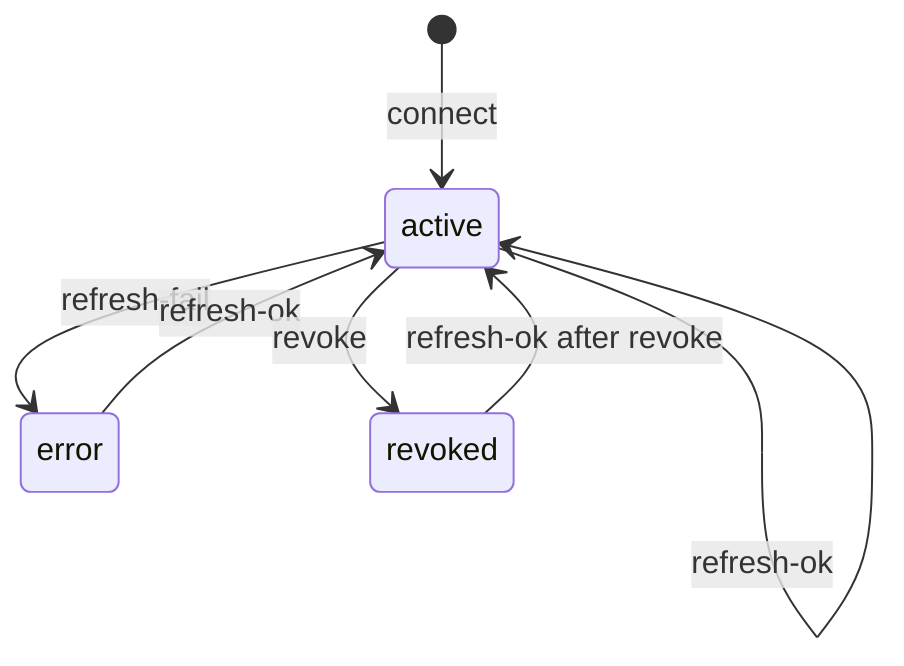
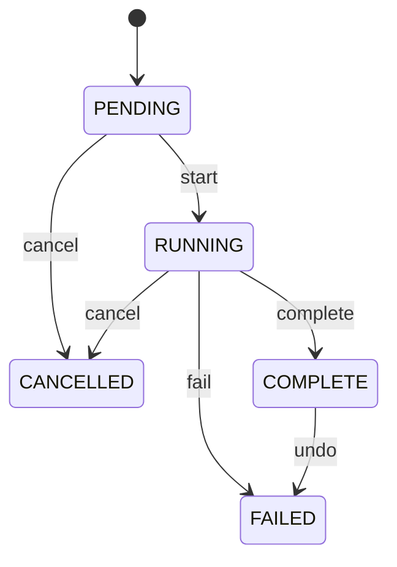
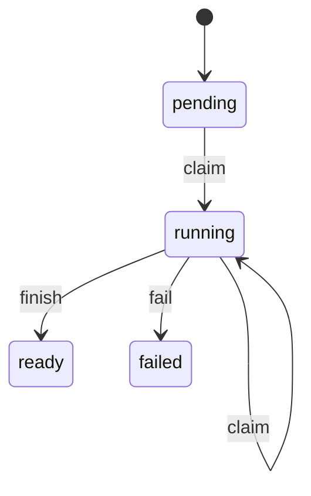
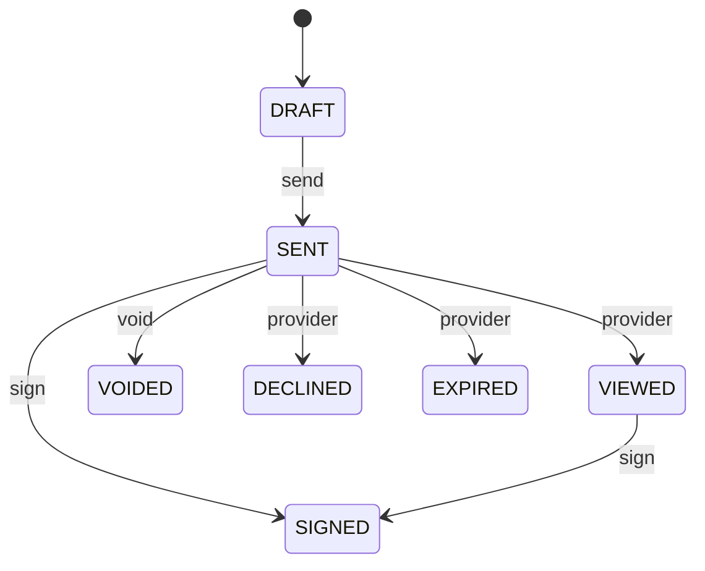
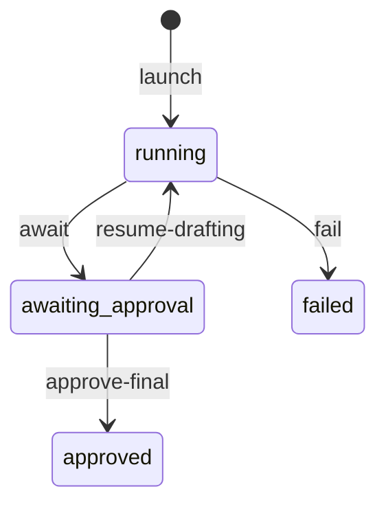
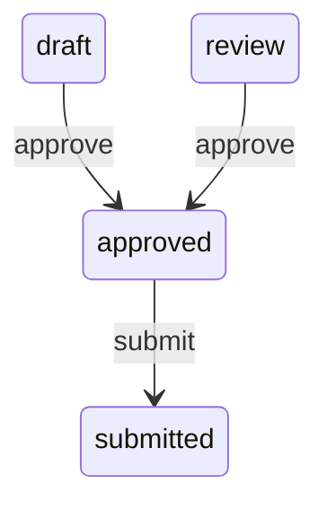
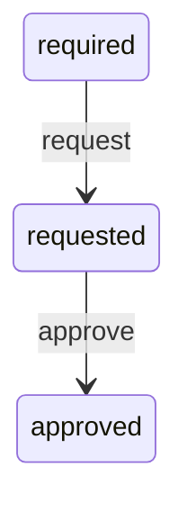
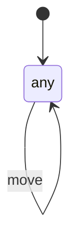

# State machines in bidstack-360
Last reviewed: 2026-11-11 at b1676ef638f08ef3f10ecefbba03eaf32c77042e (`cursor/polo-integrated-bca5`).

This inventory is the review copy for Devin. No High-risk code is in this commit. The preservation branch `cursor/state-machines-a111` (82c88c24, then local docs and two UI commits) is not this line: it is `main` 0ba51f57 plus 38 commits and does not contain this tree. It is left in place. Nothing here is copied from 82c88c24.

Risk: H means a wrong move changes a persisted job, approval, signature, export, or auth record. M means a wizard whose side effects stay in the caller. L means local UI with no CRM write. Two states and no ordering rule is NOT A MACHINE. Prisma enums that nobody treats as a lifecycle are not listed.

Status FIX means the row is a real machine and the rebuild will touch it only after this inventory is reviewed, in the order at the bottom. LATER means a real machine that is not in that order. NOT A MACHINE means it stays as it is.

## Inventory
| # | Machine | Location | Status | Risk | Notes |
|---|---|---|---|---|---|
| 1 | Integration token | apps/api/src/services/email-integration.helpers.ts:92 | FIX | H | Auth grant. 14 files update the row. Four refresh successes set `active` by id and can revive a revoked row. `expired` has no writer. |
| 2 | Access policy version | not in this tree | LATER | H | No `access_policies` route or model on b1676ef6. The preservation table is not ported: it checks legality three times, takes a string event, and hard-codes statuses. |
| 3 | Migration job | apps/api/src/routes/migrations.ts:260 | FIX | H | Cancel, complete, and undo each read a status and then update by id. Three races below. |
| 4 | Tenant export | apps/worker/src/queues/tenant-export.ts:192 | FIX | H | pending → running → ready or failed. Claim and finish already use compare-and-set. Download requires ready. |
| 5 | Data-subject erasure | apps/api/src/routes/erasure.ts:59 | NOT A MACHINE | H | One command. No status column. A second call is a no-op tombstone. The audit row is the record. |
| 6 | Signature request | apps/api/src/services/documents/signature.service.ts:320 | FIX | H | DocuSign delivery and internal sign claim a status. Void still updates by id after a read. |
| 7 | RFP orchestration | apps/worker/src/queues/rfp-orchestrator.ts:81 | FIX | H | Raw SQL writes `running`, `failed`, and `awaiting_approval` with no previous-state predicate. Approve-drafting does the same. |
| 8 | Proposal approval | apps/api/src/routes/proposals.approval.ts:67 | FIX | H | draft or review → approved, then submit. The write is compare-and-set. The RFP gate is a second writer of the same status. |
| 9 | SERUM config approval | apps/api/src/routes/serum.ts:1928 | FIX | H | required → requested → approved, under an advisory lock, then update by id. |
| 10 | Opportunity stage | apps/api/src/routes/opportunities.transitions.ts:104 | FIX | H | Any live stage is accepted. Compare-and-set stops a lost update, not an illegal jump. The preservation graph returns true when a node is missing; this line will not copy that. |
| 11 | KAM draft review | apps/api/src/routes/kam-drafts.ts:204 | LATER | H | pending → approved is already compare-and-set. Not in the first fix order. |
| 12 | Onboarding tour | apps/web/src/stores/onboarding.ts:119 | FIX | L | tourActive, dismissed, tourSeen, and the step index. After the H rows. |
| 13 | Public sign steps | apps/web/src/pages/PublicSignPage.tsx:50 | FIX | M | welcome, sign, submit, confirm. `goTo` takes any step. The persisted sign is row 6. After the H rows. |
| 14 | OAuth refresh lock | apps/api/src/lib/oauth-refresh-lock.ts:63 | NOT A MACHINE | L | A mutex. Held or not. The token row is the machine. |
| 15 | HubSpot job rollup | not in this tree | NOT A MACHINE | L | No sync-now rollup on this line. A pure fold of job statuses is not a lifecycle. |
| 16 | Intake stepper | apps/web/src/pages/IntakePage.tsx:145 | NOT A MACHINE | L | The stepper button calls `setStep` for every step. No lock and no order. |
| 17 | Quickstart checklist | apps/web/src/stores/onboarding.ts | NOT A MACHINE | L | Independent items. No order. |

## Integration token
- Purpose: A stored OAuth grant for Gmail, Microsoft Graph, Slack, or Twilio, from connect through refresh and revoke.
- Code: no reducer. Writers of `status` are listed below. Tests: none for the revoke/refresh race.
- Persisted: yes, `integration_tokens.status` (`IntegrationTokenStatus`: active, expired, revoked, error). No status version. `expired` is in the enum and has no writer in application code.

### States
| State | Data carried | Meaning |
|---|---|---|
| active | ciphertext, expiresAt | Usable grant |
| error | errorMessage | Refresh was rejected |
| revoked | deletedAt | User disconnected |
| expired | expiresAt | Enum value, no writer found |

### Events
| Event | Source |
|---|---|
| connect | OAuth callback |
| refresh-ok | API `refreshGmailToken` / `refreshMsGraphToken`, worker `email-sync.helpers.ts` `refreshMsGraphToken`, calendar sync |
| refresh-fail | Same functions, on a non-OK token response |
| revoke | DELETE disconnect for Gmail, Microsoft mail, Slack |

### Transitions the code performs
| From | Event | Guard | To | Side effects |
|---|---|---|---|---|
| any | connect | unique (org, user, provider) | active | store ciphertext |
| any, including revoked | refresh-ok | `where: { id }` only | active | replace ciphertext, clear errorMessage |
| any | refresh-fail | `where: { id }` only | error | set errorMessage |
| any not already soft-deleted by a tighter where | revoke | org, user, provider. No status predicate | revoked | set deletedAt |

Anything not in this table is illegal and is rejected and logged. That rule is not implemented.

The race, characterized and not fixed: a refresh reads the row, the user disconnects (status revoked, deletedAt set), and the refresh then `update`s by id and sets status active. `deletedAt` is left set, so the row is both soft-deleted and active. The API and the worker each have their own Microsoft refresh (`email-integration.helpers.ts:106` and `email-sync.helpers.ts:43`). There is no `worker/lib/workspace-token.ts` on this line. The four writes that set `active` by id, with no status and no `deletedAt` predicate, are `email-integration.helpers.ts:92` (Gmail), `email-integration.helpers.ts:144` (Graph), `microsoft-graph-auth.service.ts:145` (Graph again, in the API), and `email-sync.helpers.ts:82` (Graph in the worker). The matching failure writes set `error` by id at `email-integration.helpers.ts:82` and `:134`, `microsoft-graph-auth.service.ts:130`, and `email-sync.helpers.ts:67`. Disconnect does not filter on status: `integrations/gmail.ts:282`, `integrations/microsoft-mail.ts:314`, `integrations/slack.ts:375`. Other `integrationToken.update` calls (delta cursors in the Graph, Gmail, and calendar sync) do not assign `status`. Connect is a separate event and is allowed to store a new active grant.

### Platform / flag differences
none

## Access policy version
- Purpose: Not present. This tree has no policy-version status.
- Code: none. The preservation file `packages/shared/src/access-policy-status.ts` is not on this branch.
- Persisted: no.

No states, events, or transitions to copy. Porting that table would bring a string event, a thrown helper, literal status lists, and three checks (`transition`, `fromStatuses`, `statusAfter`) around one write. Statuses, when this feature exists on this line, have to come from the Prisma enum. One check decides the write.

### Platform / flag differences
none

## Migration job
- Purpose: One CSV or HubSpot import, from the row being created through cancel, complete, fail, or undo.
- Code: no reducer. apps/api/src/routes/migrations.ts and apps/worker/src/queues/migration.ts. Tests do not cover the three races below.
- Persisted: yes, `migration_jobs.status` (PENDING, RUNNING, COMPLETE, FAILED, CANCELLED). No status version. Undo stores FAILED plus `meta.undone`. That encoding is what the code does today.

### States
| State | Data carried | Meaning |
|---|---|---|
| PENDING | upload | Row created, worker may not have started |
| RUNNING | startedAt | Worker may import |
| COMPLETE | completedAt, undoableUntil | Import finished |
| FAILED | error summary, or meta.undone | Failed, or undone |
| CANCELLED | completedAt | Cancelled |

### Events
| Event | Source |
|---|---|
| start | Job create / worker pickup |
| cancel | DELETE /migrations/:id/cancel |
| complete | Worker `maybeComplete` |
| fail | Unknown entity, or retries exhausted |
| undo | DELETE /migrations/:id/undo |

### Transitions the code intends
| From | Event | Guard | To | Side effects |
|---|---|---|---|---|
| PENDING | start | none in a shared table | RUNNING | set startedAt |
| PENDING, RUNNING | cancel | read says not COMPLETE, CANCELLED, or FAILED | CANCELLED | set completedAt, audit |
| RUNNING | complete | processed + error rows cover the total | COMPLETE | set completedAt, undoableUntil |
| RUNNING | fail | exhausted-retry path also requires status RUNNING | FAILED | set completedAt |
| COMPLETE | undo | read says COMPLETE and undoableUntil is in the future | FAILED | delete imported rows, set meta.undone |

The three races, each a read followed by an update that does not repeat the status in the WHERE:

1. Cancel overwrites COMPLETE. `migrations.ts:260` rejects a terminal status in memory. `migrations.ts:263` then updates `{ id }` to CANCELLED. A worker can mark COMPLETE between the read and the write.
2. Complete overwrites CANCELLED. `migration.ts:609` returns unless the read says RUNNING. `migration.ts:613` then updates `{ id }` to COMPLETE. A cancel between the two writes wins the read and loses the row.
3. Concurrent undo. `migrations.ts:296` requires COMPLETE. `migrations.ts:363` updates `{ id }` to FAILED inside the transaction without `status: 'COMPLETE'` in the WHERE. Two undos can both pass the read and both delete.

A fourth write, not one of the three named races: an unknown entity sets FAILED by id with no status predicate (`migration.ts:671`). The exhausted-retry path does use `status: 'RUNNING'` (`migration.ts:814`). The preservation commit reused a fail-from list as the "is this job active" test. That list is not on this line, and it will not be added. A compare-and-set uses the from-status of that one event.

### Platform / flag differences
none

## Tenant export
- Purpose: An org admin asks for a portability archive. The worker builds it, and download is allowed only when it is ready.
- Code: no reducer. apps/api/src/routes/tenant-export.ts:50 and apps/worker/src/queues/tenant-export.ts:192. The worker already compare-and-sets.
- Persisted: yes, `tenant_exports.status` (pending, running, ready, failed, expired). No status version.

### States
| State | Data carried | Meaning |
|---|---|---|
| pending | requestedById | Queued |
| running | startedAt | Worker claimed it |
| ready | storageKey, expiresAt, sizeBytes | Download allowed |
| failed | error | Worker stopped |
| expired | expiresAt | Enum value. No writer found in the worker |

### Events
| Event | Source |
|---|---|
| request | POST export. Refused while one is pending or running |
| claim | Worker |
| finish | Worker, after the archive uploads |
| fail | Worker catch |
| download | GET, only when ready |

### Transitions
| From | Event | Guard | To | Side effects |
|---|---|---|---|---|
| pending, running | claim | updateMany on those statuses | running | set startedAt |
| running | finish | updateMany on running | ready | store key, size, expiry |
| running | fail | updateMany on running | failed | store error |
| ready | download | status is ready and storageKey is set | ready | sign a fresh URL |

### Platform / flag differences
none

## Data-subject erasure
- Purpose: An admin tombstones one contact or lead.
- Code: apps/api/src/routes/erasure.ts. No status field.
- Persisted: the subject's own columns and one `gdpr.erasure` audit row. No request row.

Not a machine. There is no status to move, and a repeated call is the same tombstone.

### Platform / flag differences
none

## Signature request
- Purpose: An envelope moves from draft through sent and viewed to a terminal outcome, and a second delivery must not append another audit event.
- Code: no reducer. apps/api/src/services/documents/signature.service.ts. DocuSign and internal sign already claim with updateMany.
- Persisted: yes, `signature_requests.status` (DRAFT, SENT, VIEWED, SIGNED, DECLINED, VOIDED, EXPIRED). No status version.

### States
| State | Data carried | Meaning |
|---|---|---|
| DRAFT | recipients | Not sent |
| SENT | sentAt, providerRequestId | Waiting |
| VIEWED | recipients | A recipient opened it |
| SIGNED | completedAt, completedDocumentS3Key | Done |
| DECLINED |  | Recipient declined |
| VOIDED | voidedAt, voidReason | Sender voided |
| EXPIRED |  | Provider says expired |

### Events
| Event | Source |
|---|---|
| send | sendSignatureRequest |
| provider | DocuSign webhook |
| sign | Public /sign/:token |
| void | voidSignatureRequest |

### Transitions the code performs
| From | Event | Guard | To | Side effects |
|---|---|---|---|---|
| DRAFT | send | read | SENT | provider call or internal token |
| not the target, and not SIGNED, VOIDED, DECLINED, EXPIRED | provider | updateMany | the mapped status | one SignatureEvent |
| not SIGNED or VOIDED | sign | updateMany | SIGNED | PDF, then the key is already stored |
| not SIGNED, DECLINED, VOIDED, EXPIRED | void | read, then update by id | VOIDED | provider void, then the row |

The void path (`signature.service.ts:377` then `:403`) can void a request that became SIGNED after the read. The webhook path refuses terminal statuses in the WHERE. Those two guards disagree.

### Platform / flag differences
DocuSign uses the webhook. INTERNAL uses the public page. The status enum is the same.

## RFP orchestration
- Purpose: One RFP run, from queued through the drafting pause to approved, completed, or failed.
- Code: no reducer. Raw SQL in apps/worker/src/queues/rfp-orchestrator.ts, apps/worker/src/queues/rfp-requirement-extract.helpers.ts, and apps/api/src/routes/rfp-pipeline.ts.
- Persisted: yes, `rfp_orchestrations.state` (queued, running, paused, approved, rejected, awaiting_approval, completed, failed). No status version. `paused` and `rejected` have no writer in these three files.

### States
| State | Data carried | Meaning |
|---|---|---|
| queued |  | Default. The worker upsert does not leave it here |
| running | currentPhase, rootJobId | Pipeline moving |
| awaiting_approval | completedPhases | Human gate |
| approved |  | Final gate passed |
| completed | completedAt | Not written by the files above |
| failed | failedPhase, failureReason | Stopped |
| paused, rejected |  | Enum values, no writer in these files |

### Events
| Event | Source |
|---|---|
| launch | Worker upsert on conflict |
| await | markOrchestrationAwaitingApproval |
| approve-final | RFP approve route, WHERE state = awaiting_approval |
| resume-drafting | approve-drafting route |
| fail | markOrchestrationFailed and the stuck-run sweep |

### Transitions the code performs
| From | Event | Guard | To | Side effects |
|---|---|---|---|---|
| any on that (org, rfp) | launch | conflict target only | running | resets phase and failure |
| any | await | id and org only | awaiting_approval | append qa_review |
| awaiting_approval | approve-final | WHERE state and a proposal claim | approved | proposal becomes approved |
| any | resume-drafting | read says awaiting_approval, write does not | running | enqueue section drafts |
| any | fail | id and org only | failed | store the reason |
| queued, running | sweep | updated_at older than the cutoff | failed | reaper |

`rfp-pipeline.ts:571` sets running with no state predicate after the read at line 547. A concurrent fail between them is overwritten back to running.

### Platform / flag differences
The final approve route also requires `humanReviewRequired`, no open high or critical review issue, and `qa_review` already in completedPhases. Those are guards on the proposal write, not a second orchestration machine.

## Proposal approval
- Purpose: A proposal becomes approved only with `proposals:approve` and an attestation, and submit moves an approved version once.
- Code: no reducer. apps/api/src/routes/proposals.approval.ts. The RFP gate in rfp-pipeline.ts also sets `status: 'approved'`.
- Persisted: yes, proposal status. The route treats draft, review, approved, submitted, won, lost as the lifecycle. No status version.

### States
| State | Data carried | Meaning |
|---|---|---|
| draft | version | Editable |
| review | version | Editable, approvable |
| approved | approvedAt, approvedByUserId | Locked |
| submitted | version | Sent once |
| won, lost |  | Outcome |

### Events
| Event | Source |
|---|---|
| approve | POST /proposals/:id/approve, or the RFP gate |
| submit | POST /proposals/:id/submit |

### Transitions
| From | Event | Guard | To | Side effects |
|---|---|---|---|---|
| draft, review | approve | updateMany on those statuses. RFP-linked rows are refused here | approved | audit proposal.approved |
| awaiting_approval orchestration | approve | the RFP route's own claim | approved | orchestration to approved |
| approved, with approver recorded | submit | read | submitted | one event key per version |

Two writers set the same status. A single table has to own both entries.

### Platform / flag differences
An RFP-linked proposal is refused by `proposals.approval.ts` and approved by the RFP gate instead.

## SERUM config approval
- Purpose: A high-risk SERUM draft is requested by one admin and approved by a different admin.
- Code: no reducer. apps/api/src/routes/serum.ts, from the request handler at line 1874 and the approve handler at line 1964.
- Persisted: yes, `approvalStatus` on the config version (not_required, required, requested, approved). The row status (draft versus published) is a second field. No status version.

### States
| State | Data carried | Meaning |
|---|---|---|
| not_required |  | Section does not need this gate |
| required |  | Waiting for a request |
| requested | approvalRequestedByUserId | Waiting for the other admin |
| approved | approvedByUserId | May be published |

### Events
| Event | Source |
|---|---|
| request | POST .../request-approval |
| approve | POST .../approve |

### Transitions
| From | Event | Guard | To | Side effects |
|---|---|---|---|---|
| required, and row status draft | request | advisory lock, config tests pass, not already requested or approved | requested | audit |
| requested, requester is someone else | approve | same lock, config tests pass | approved | audit |

The update is by id. The lock is what stops two admins on the same config key. A writer that does not take the lock is not covered.

### Platform / flag differences
Only config types that `configRequiresApproval` accepts enter this table. Others stay not_required.

## Opportunity stage
- Purpose: A kanban move of an opportunity.
- Code: no graph on this line. apps/api/src/routes/opportunities.transitions.ts:68. Compare-and-set is the previous stage plus previous pipelineStageId (`:104`).
- Persisted: yes, `opportunity.stage` and `pipelineStageId`. No status version.

### States
The states are the org's pipeline stages, plus the legacy enum `s1_lead`, `s1_ongoing`, `s2_sent`, `s3_technical_iteration`, `s4_negotiation`, `closed_won`, `closed_lost`.

### Events
| Event | Source |
|---|---|
| move | POST /opportunities/:id/stage |

### Transitions the code performs
| From | Event | Guard | To | Side effects |
|---|---|---|---|---|
| the stage just read | move | target id exists, or the body stage is one of the seven enum values | that stage | audit, Dust, webhook |

A missing pipeline stage id is a 400. A stage key with no row still writes the enum (`:93`–`:97`). There is no one-step rule. Skipping from `s1_lead` to `closed_won` is allowed.

The preservation function `isLegalStageTransition` returns true when `from` is null or either node is missing from the active list. That is fail-open. It is not on this line. A graph added here rejects an unknown node. Adding that graph changes today's behavior: jumps that succeed now would be refused. That is a product change, so the graph is not added in this commit.

### Platform / flag differences
none on this line. The preservation line had a mode flag (off, warn, enforce). It is not here.

## Onboarding tour
- Purpose: A six-step product tour, plus whether it was dismissed or finished.
- Code: still inline in apps/web/src/stores/onboarding.ts. Not changed on this branch.
- Persisted: localStorage `bidstack-onboarding.v1:<userId>`. The step index and tourActive are not stored.

FIX after the H rows. Several flags describe one tour, and finishing the last step clears dismissed.

### Platform / flag differences
none

## Public sign steps
- Purpose: The public signing page walks welcome → sign → submit → confirm, then the signature service claims SIGNED.
- Code: apps/web/src/pages/PublicSignPage.tsx:50. `goTo` accepts any of the four steps.
- Persisted: the page step is not stored. The request row is row 6.

FIX after the H rows. The page must not be a second writer of `signature_requests.status`.

### Platform / flag differences
none

## OAuth refresh lock
- Purpose: One refresh of a token id at a time.
- Code: apps/api/src/lib/oauth-refresh-lock.ts.
- Persisted: Redis key, not a status column.

Not a machine. The integration token row is the machine.

### Platform / flag differences
none

## HubSpot job rollup
Not on this line. Folding several job statuses into one label is a pure map. It is not a lifecycle, and it does not get a reducer.

### Platform / flag differences
none

## Intake stepper
- Purpose: Receive, extract, review, publish.
- Code: apps/web/src/pages/IntakePage.tsx:145. Every stepper button calls `setStep` with that step. Nothing disables a later step.
- Persisted: no.

Not a machine until someone decides an order is required. Today it is a tab.

### Platform / flag differences
none

## Quickstart checklist
A set of independent checklist items on the onboarding store. No order. Not a machine.

### Platform / flag differences
none

## Fix order, after this inventory is reviewed
No High-risk edit starts before that review.

1. Integration token.
2. Access policy, only if this tree grows that model. Do not port the preservation table.
3. Migration job. One commit. Each of the three races closed with compare-and-set and a red-first database test.
4. Tenant export, and erasure stays as it is.
5. Proposal approval and the SERUM gate, then signature request. One machine per commit.
6. RFP orchestration.
7. Onboarding, then the public sign steps.

Rules for those commits, from the review of the preservation attempt:

- One machine per commit.
- `transition(state, event)` takes a typed event. It returns the next state or a rejected result. It does not throw, and it does not log. The caller logs the rejection with ids and states only.
- One legality check. The write's compare-and-set uses that result. No parallel from-status list and no `statusAfter` helper.
- Status unions are derived from the Prisma enum. No second literal list.
- Do not reuse one event's from-list as a test that the row is "active".
- Unknown or legacy stored values map to a defined safe state and are not rewritten unless a migration says so.
- Opportunity stage, if a graph is added, fails closed on an unknown node.
