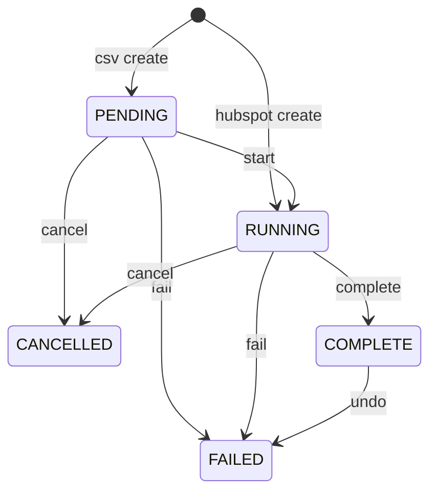
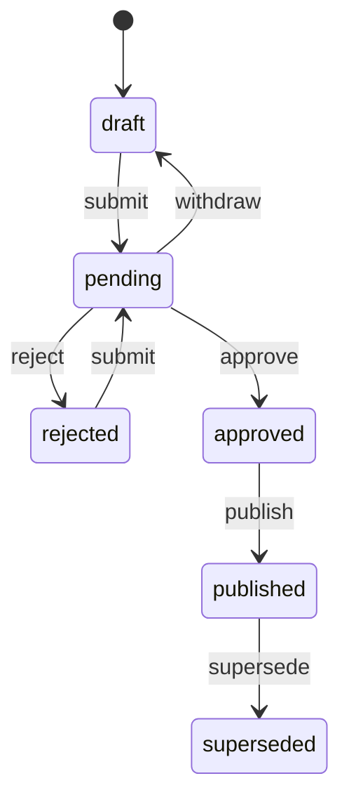
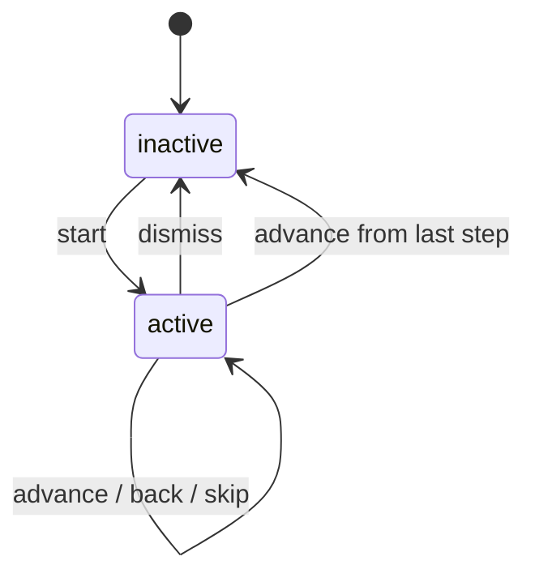
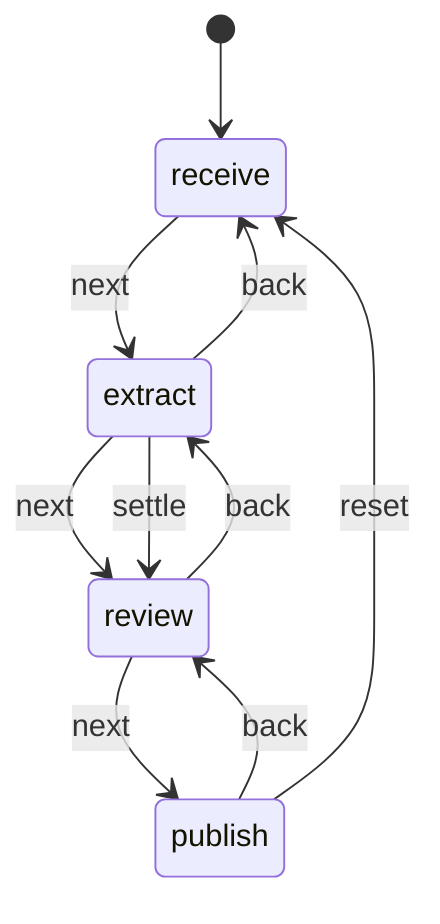

# State machines in bidstack-360
Last reviewed: 2026-11-11. Inventory commit 663aaeb2. Standard: Devin v1, sha256 c62dff48dc032e70df170c3161709ae7bfb79f1e25db473b730a300cedb82f0c. No High-risk edit after the inventory.

Risk: H means a wrong move changes a persisted job, approval, signature, export, or auth record. M means a wizard whose side effects stay in the caller. L means local UI with no CRM write. A candidate with two states and no ordering rule is NOT A MACHINE.

High-risk rows are not edited in this pass. The two H machines marked FIXED were coded in 82c88c24, before this inventory. They are recorded here for review and are not being extended.

## Inventory
| # | Machine | Location | Status | Risk | Notes |
|---|---|---|---|---|---|
| 1 | Migration job | apps/api/src/routes/migrations.ts:240, apps/worker/src/queues/migration.ts:705 | FIXED | H | Table in 82c88c24, before this inventory. Late chunk could overwrite a finished job. No further edit. |
| 2 | Access policy version | apps/api/src/routes/access-policies.ts:295 | FIXED | H | Table in 82c88c24, before this inventory. Compare-and-swap kept. No further edit. |
| 3 | HubSpot sync rollup | apps/api/src/services/sync-now/runs.ts:96 | FIXED | M | Pure rollup of the migration jobs. Behaviour unchanged. Quirks pinned by tests. |
| 4 | Onboarding tour | apps/web/src/stores/onboarding-tour.ts | FIXED | L | Reducer. Corrupt stored steps become []. Back from step 0 is rejected and logged. |
| 5 | Intake stepper | apps/web/src/pages/intake/intake-step.ts | FIXED | M | Table for next, back, jump, settle, reset. Extraction and toasts stay in the page. |
| 6 | Upload start | apps/api/src/routes/migrations.ts:247 | LATER | H | Lock, digest, and unique index already guard it. A reducer would sit on the import write path. |
| 7 | Agreement ingest item | apps/api/src/services/agreement-ingest/process.ts:443 | LATER | H | queued ↔ processing, retry. Persisted pipeline. |
| 8 | Agreement source sync | apps/api/src/services/agreement-sources/sync.ts:163 | LATER | H | processing / failed / retry. Persisted pipeline. |
| 9 | OAuth refresh lock | apps/api/src/lib/oauth-refresh-lock.ts:69 | LATER | H | Acquire, refresh, wait, timeout. Auth lifecycle. |
| 10 | Public signature | apps/web/src/pages/PublicSignPage.tsx:51 | LATER | H | welcome → sign → submit → confirm. goTo() accepts any step. Signature submit. |
| 11 | Send for signature | apps/web/src/components/signatures/SendForSignatureModal.tsx:193 | LATER | H | Steps 0, 1, 2. Signature request. |
| 12 | Proposal approval | apps/api/src/routes/proposals.approval.ts:67 | LATER | H | draft / approved writes. Approval. |
| 13 | KAM draft review | apps/api/src/routes/kam-drafts.ts:205 | LATER | H | pending → approved or rejected. Approval. |
| 14 | Tenant export | apps/api/src/routes/tenant-export.ts:51 | LATER | H | pending / running gate, ready required to download. Export of tenant data. |
| 15 | Redis shared client | apps/api/src/redis.ts:17 | LATER | H | ioredis status plus reconnect warning. Connection lifecycle for every caller. |
| 16 | Opportunity stage | packages/shared/src/stage-transitions/index.ts:29 | FIXED | M | Already a pure table before this sweep. Not reopened. |
| 17 | Dust sync mapping | apps/api/src/services/sync-now/runs.ts:32 | NOT A MACHINE | L | Pure map from a BullMQ state string. No ordering rule of its own. |
| 18 | Template picker | apps/web/src/stores/onboarding.ts:90 | NOT A MACHINE | L | One boolean, open or closed, no ordering. |
| 19 | Quickstart checklist | apps/web/src/stores/onboarding.ts:170 | NOT A MACHINE | L | A set of independent items. No order between them. |

## Migration job
- Purpose: One CSV or HubSpot import, from the row being created through cancel, complete, fail, or undo.
- Code: packages/shared/src/migration-status.ts, tests: packages/shared/src/migration-status.test.ts
- Persisted: yes, migration_jobs.status (Prisma enum). No version column. Unknown values are not remapped. Undo stores FAILED and meta.undone; that encoding was not changed.

### States
| State | Data carried | Meaning |
|---|---|---|
| PENDING | upload id, digest | CSV row exists, chunks may already be queued |
| RUNNING | startedAt | Worker may import |
| COMPLETE | completedAt, undoableUntil | Import finished |
| FAILED | error summary, or meta.undone | Failed, or undone |
| CANCELLED | completedAt | Cancelled before finish |

Birth is not an event. CSV creates PENDING. HubSpot creates RUNNING.

### Events
| Event | Source |
|---|---|
| start | API finishStart |
| cancel | DELETE /migrations/:id/cancel |
| complete | Worker, when processed + error rows cover the total |
| fail | Worker, unknown entity or retries exhausted |
| undo | DELETE /migrations/:id/undo |

### Transitions
| From | Event | Guard | To | Side effects |
|---|---|---|---|---|
| PENDING | start | row still PENDING | RUNNING | set startedAt |
| PENDING, RUNNING | cancel | none | CANCELLED | set completedAt, audit |
| RUNNING | complete | counts cover total | COMPLETE | set completedAt, undoableUntil |
| PENDING, RUNNING | fail | compare-and-swap on those two | FAILED | set completedAt, error summary |
| COMPLETE | undo | inside the undo window | FAILED | set meta.undone |

Anything not in this table is illegal and is rejected and logged.

### Platform / flag differences
none

## Access policy version
- Purpose: A policy moves from draft to published only with a second admin, and publishing supersedes the live row.
- Code: packages/shared/src/access-policy-status.ts, tests: packages/shared/src/access-policy-status.test.ts. The route still does the compare-and-swap.
- Persisted: yes, access_policy_versions.status. No version column on the status. A rollback creates a new pending row; it does not move the superseded one.

### States
| State | Data carried | Meaning |
|---|---|---|
| draft | rules, author | Editable by the author |
| pending | submittedBy, submittedAt | Waiting for a second admin |
| approved | approvedBy, note | May be published |
| rejected | note | Author may submit again |
| published | version, publishedAt | The live policy |
| superseded | version | A previous live policy |

### Events
| Event | Source |
|---|---|
| submit | POST .../submit |
| withdraw | POST .../withdraw |
| approve | POST .../approve |
| reject | POST .../reject |
| publish | POST .../publish |
| supersede | Same publish, on the previous live row |

### Transitions
| From | Event | Guard | To | Side effects |
|---|---|---|---|---|
| draft, rejected | submit | author, rules still valid on later publish | pending | audit submit |
| pending | withdraw | author or submitter | draft | clear submittedBy |
| pending | approve | not the author or submitter, expectedUpdatedAt | approved | audit |
| pending | reject | same | rejected | audit |
| approved | publish | rules valid | published | version number, audit |
| published | supersede | a newer publish is committing | superseded | none on its own |

Anything not in this table is illegal and is rejected and logged. The route returns 409, which is the documented contract.

### Platform / flag differences
Enforcement of the published rules is off unless ACCESS_POLICIES_ENFORCE=true. The transition table does not read that flag.

## HubSpot sync rollup
- Purpose: Show one Sync now state for every entity job in a HubSpot run.
- Code: hubspotAggregateState in apps/api/src/services/sync-now/runs.ts, tests: apps/api/src/services/sync-now/sync-now.test.ts
- Persisted: no. Derived from migration_jobs rows.

### States
| State | Data carried | Meaning |
|---|---|---|
| queued | none | Nothing has startedAt, or a RUNNING row has no startedAt |
| running | progress | Some entity still going |
| completed | counts | Every entity COMPLETE |
| failed | reasons | An entity FAILED or CANCELLED, and nothing is still PENDING or RUNNING |

### Events
| Event | Source |
|---|---|
| (none) | The function is a pure fold of the current rows, not a stored machine |

### Transitions
Not a stored machine. The fold is the whole rule. CANCELLED is reported as failed. A RUNNING row with no startedAt is reported queued. Both are pinned by tests and were not changed.

### Platform / flag differences
none

## Onboarding tour
- Purpose: A six-step product tour, plus whether it was dismissed or finished.
- Code: apps/web/src/stores/onboarding-tour.ts, tests: apps/web/src/stores/onboarding-tour.test.ts. The zustand store is the only writer.
- Persisted: yes, localStorage key `bidstack-onboarding.v1:<userId>`, version 1 inside the JSON. Step index and whether the tour is open are not stored. A non-array or out-of-range completedSteps loads as the in-range unique steps. Unreadable JSON is left untouched.

### States
| State | Data carried | Meaning |
|---|---|---|
| inactive | step, completed, dismissed, seen | Tour closed |
| active | step 0–5, completed, dismissed, seen | Tour open at that step |

start after dismiss keeps dismissed true. Finishing the last step clears dismissed and sets seen.

### Events
| Event | Source |
|---|---|
| start | Topbar |
| advance | Product tour next |
| back | Product tour back |
| skip | skipToStep |
| dismiss | Product tour dismiss |
| complete | completeTourStep |

### Transitions
| From | Event | Guard | To | Side effects |
|---|---|---|---|---|
| either, any step | start | none | active at 0 | none |
| either, step 0–4 | advance | none | same phase, step+1, step marked completed | persist |
| either, step 5 | advance | none | inactive, seen, dismissed false, step marked completed | persist |
| either, step 1–5 | back | not step 0 | same phase, step−1 | none |
| either | skip | step in 0–5 | active at that step | none |
| either | dismiss | none | inactive, dismissed, seen | persist |
| either | complete | step in 0–5 | same phase, step added once | none |

Anything not in this table is illegal and is rejected and logged. Back from 0, and skip or complete outside 0–5, are the illegal pairs.

### Platform / flag differences
none. The tour does not auto-start.

## Intake stepper
- Purpose: Receive documents, extract, review, publish. The stepper may return to a step already reached, and a finished extraction on the account unlocks review after reload.
- Code: apps/web/src/pages/intake/intake-step.ts, tests: apps/web/src/pages/intake/intake-step.test.ts. IntakePage is the only writer.
- Persisted: the step is not stored. Account extractions are. reached is session state. No version.

### States
| State | Data carried | Meaning |
|---|---|---|
| receive | reached | Choosing documents |
| extract | reached | Running extraction |
| review | reached | Checking the extraction |
| publish | reached | Committing it |

### Events
| Event | Source |
|---|---|
| next | Step body |
| back | Step body |
| jump | Stepper button |
| settle | Extraction effect, when at least one document succeeded |
| reset | Publish done |

### Transitions
| From | Event | Guard | To | Side effects |
|---|---|---|---|---|
| receive | next | none | extract | none in the reducer |
| extract | next | none | review | none in the reducer |
| review | next | none | publish | none in the reducer |
| extract | back | none | receive | none |
| review | back | none | extract | none |
| publish | back | none | review | none |
| any | jump | target index ≤ unlocked | that step | none |
| any | settle | none | review | toasts stay in the page |
| any | reset | none | receive, reached 0 | page clears the selection |

unlocked is max(reached, 2) when the account has a finished extraction, otherwise reached. Anything not in this table is illegal and is rejected and logged. Next from publish, back from receive, and a jump past unlocked are the illegal pairs.

### Platform / flag differences
none

## Left for later
Rows 6–15 stay as they are. Each is H: a wrong move changes a persisted job, an approval, a signature, an export, or a connection. They are not edited in this pass. Opportunity stage (row 16) is already a pure table and was not reopened. Rows 17–19 are not machines.
