# Sweep 06 — error paths and resilience

Lens: a failed request shows a clear, translated sentence. No stack trace, no schema-compiler text, no storage key. A failure does not wipe the form or pretend the book is empty.

Date: 2026-11-21. Base: `main` at `40b13242` (merge of #70).

Synthetic only. Postgres 16 (`pgvector/pgvector:pg16`) on `127.0.0.1:5433`, Redis 7 on `127.0.0.1:6380`, API `127.0.0.1:4000`, worker, Vite `http://127.0.0.1:38081`. No Clerk key, no Dust key, no deploy. Org `Example Workspace` (`org_seed_mantu`), user `jane@example.com`. Companies **Northwind Labs** (`northwind.example.com`) and **Contoso Rail** (`contoso.example.com`). Contacts `avery.north@northwind.example.com` and `blair@contoso.example.com`. Browser: Playwright Chromium 147, viewport 1280×800.

The stub chrome still says Jane Smith / `jane@mantu.com`. That string is compiled into the stub session. The rows in Postgres are the names above.

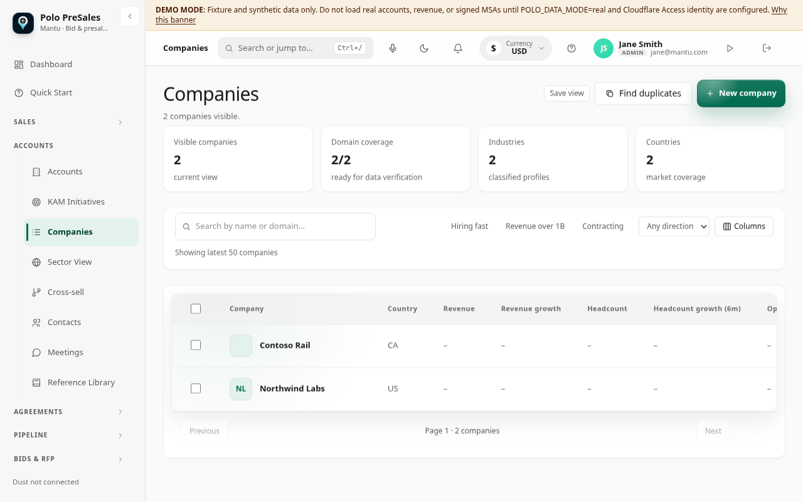

## What was already covered

| Topic | Where |
| --- | --- |
| Deliberate 503 stays 503. A crash, a forged status, and a provider body do not leak into the 500 JSON. | #348. This sweep stacks the validation envelope on that handler. |
| Import cancel, retry, and a stored job across reload. | #349. Unclosed quotes and the 8 MB browser cap are not in that diff. Three of its retry-alert tests fail on that branch without these changes. |
| Unreadable `.xlsx` bytes and a zip that declares more than 8 MB uncompressed. | #400. The browser still mapped an 11 MB `.csv` before that route runs. |
| Company create when Redis is down. | #376. |
| OAuth token text kept out of logs. | #389. |

## Findings

### 1. High — schema compiler text is the error on the page

`POST /api/v1/companies` with `{}` returned:

`body/name Required, body/legalName Required, …`

`POST /api/v1/migrations/start-csv` with `rows` as a string returned:

`body/rows Expected array, received string`

`GET /api/v1/companies/not-a-uuid` returned `params/id Invalid uuid`.

The pages print `error.message`. Companies, opportunities, contacts, leads, tasks, and pipeline showed that sentence under a translated title. In French the title was `Échec du chargement des entreprises` and the body was still the English compiler sentence. The header also said `0 entreprises visibles` and the tiles were 0.

A body over the 10 MB limit returned `error: "FastifyError"`, `message: "Request body is too large"`.

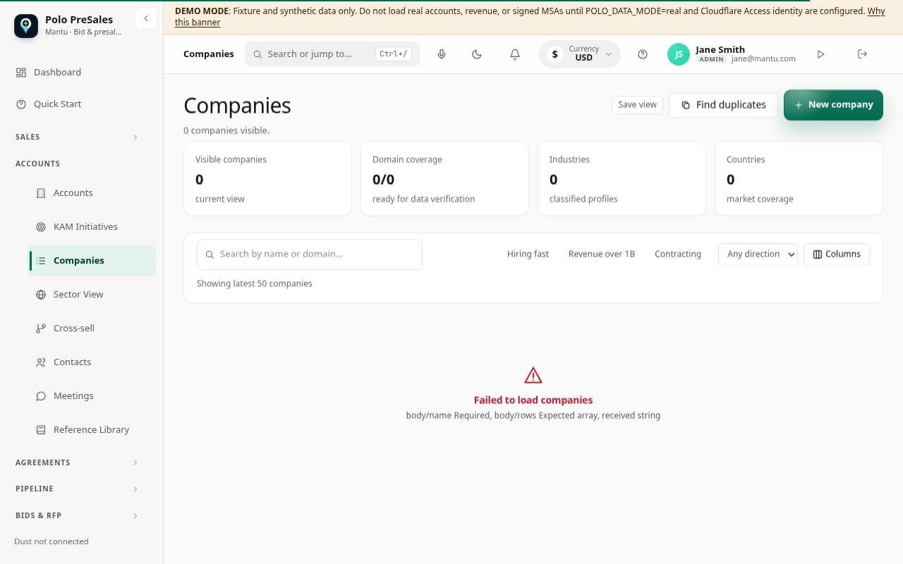

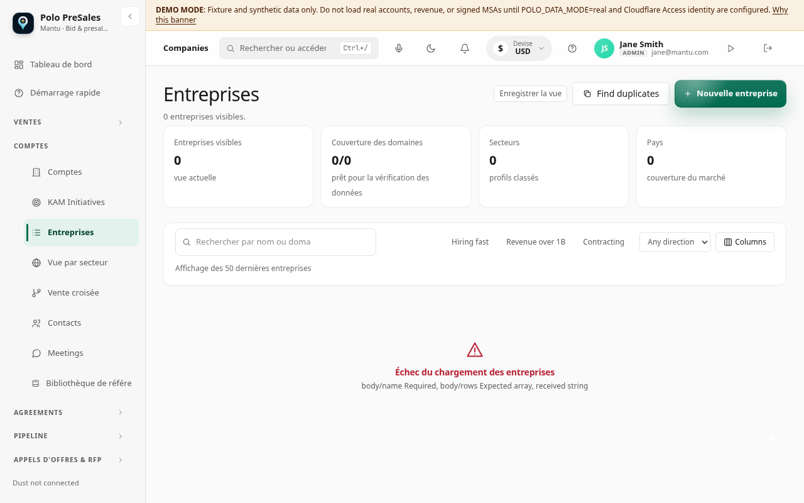

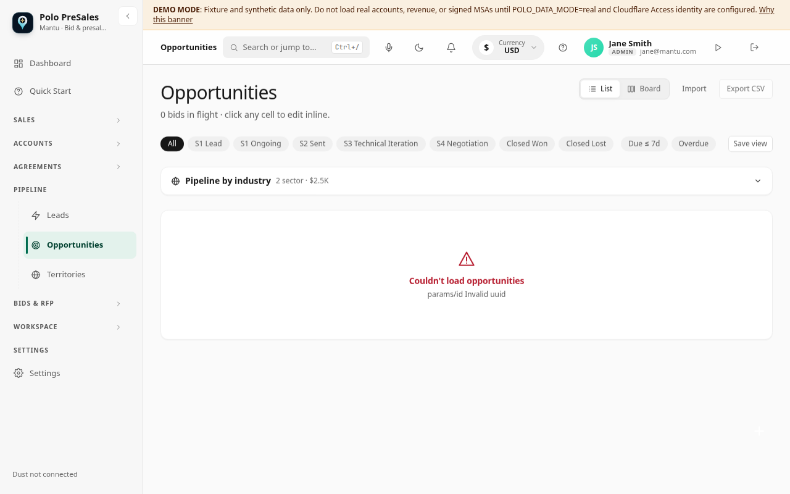

Fixed in two drafts:

- API envelope, stacked on #348: #429, head `6a166ec506dfe45bf7ca83fc00e1ef446e97e8c0`. Validation is `code: "validation"`, `message: "Validation failed"`. The body-limit error is `code: "payload_too_large"`. Compiler paths and the Zod `issues` array are not in the JSON.
- Browser sentence, from `main`: #431, head `d1a26d8e9f5f63153c97a1f3f8dcd1e45df64065`. The same compiler sentence becomes the locale string. French Chromium showed `Certains champs sont à corriger. Vérifiez-les et réessayez.`

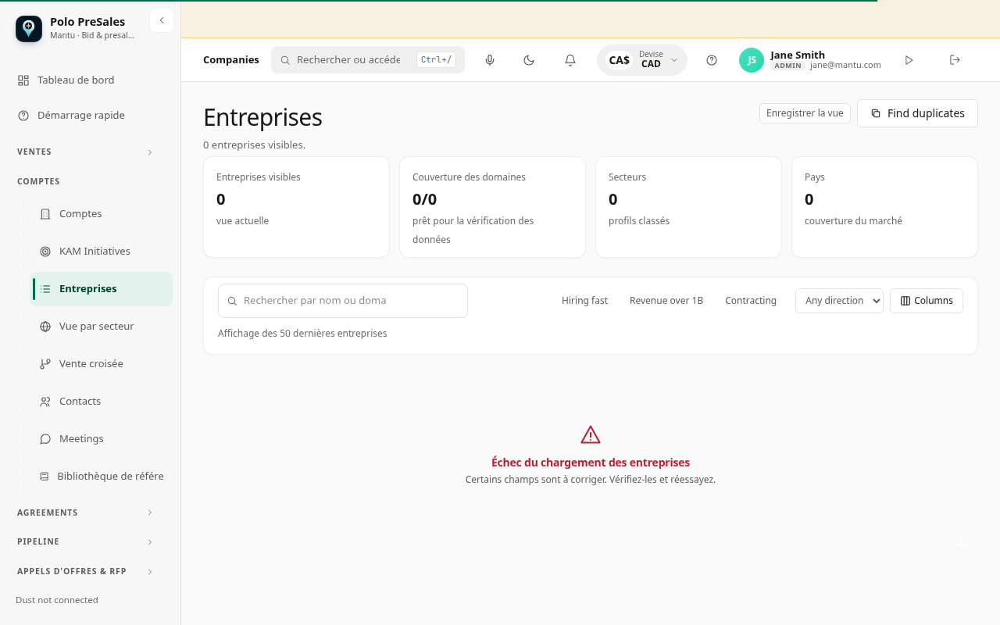

`Company not found` and `Parent company not found` still pass through. A 500 whose JSON also carried a stack and a `storageKey` did not put either string on the accounts page.

### 2. Medium — an expired session says “Invalid or expired token”

Forcing `401` with `Invalid or expired token` left the dashboard in place. The title was `Could not load dashboard`. The body was the server sentence. Stub mode has no bearer token, so the client does not sign the user out. Demo mode already clears a dead token.

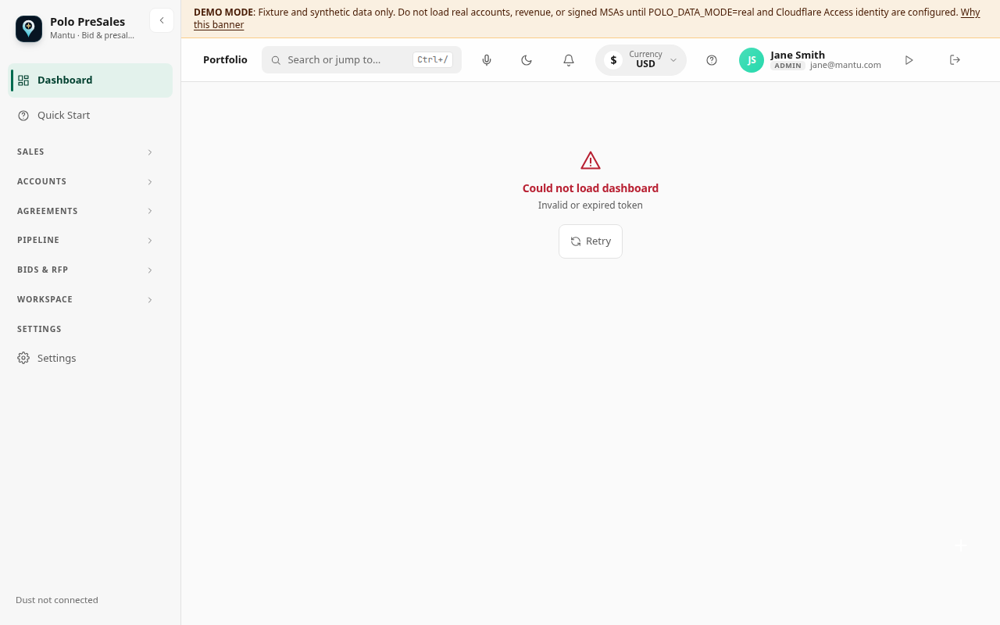

The browser change in #431 maps every 401 to `Your session expired. Sign in to continue.` (`errors.sessionExpired`). It still does not redirect a stub session, because there is no token to drop.

### 3. High — an unclosed quote becomes one corrupted row

`name,email` plus `"Northwind Labs,avery@northwind.example.com` and a following Contoso line was **1 row**. The sample glued the rest of the file into the name. The wizard offered to map it.

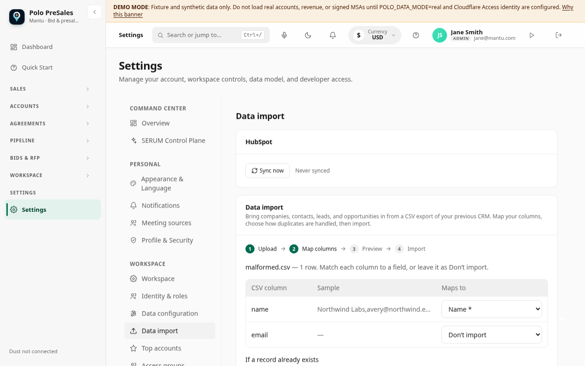

Fixed in #432, stacked on #349, head `b1d67cc6d2ab9488f7e03b29c7f557351490fd63`. `parseCsv` throws `unclosed quote`. The wizard already turns a parse throw into `csvImport.error.unreadable`.

### 4. Medium — an 11 MB file is mapped

A CSV whose only cell was 11 MB of `N` was accepted as one row. The sample was the raw bytes.

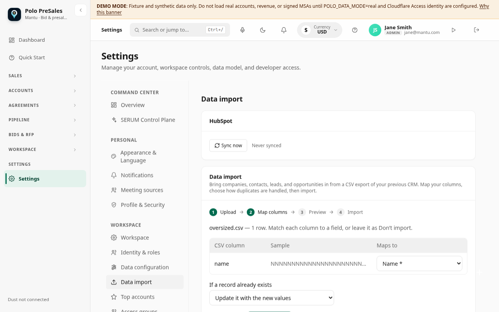

Fixed in #434, stacked on #432 (GitHub only grows that stack at the top; #432 is already above #349), head `13620922eed9761039dc77688976bc6dc36317ce`. Files over 8 MB stop on the upload step with `csvImport.error.tooLarge`. #400 remains the server-side spreadsheet cap.

### 5. Medium — a slow or failed list is described as empty

Opportunities, held open for 3.5 s, showed a skeleton and `0 bids in flight` for the whole wait. Companies on error showed `0 companies visible` and zero tiles beside the error (see finding 1).

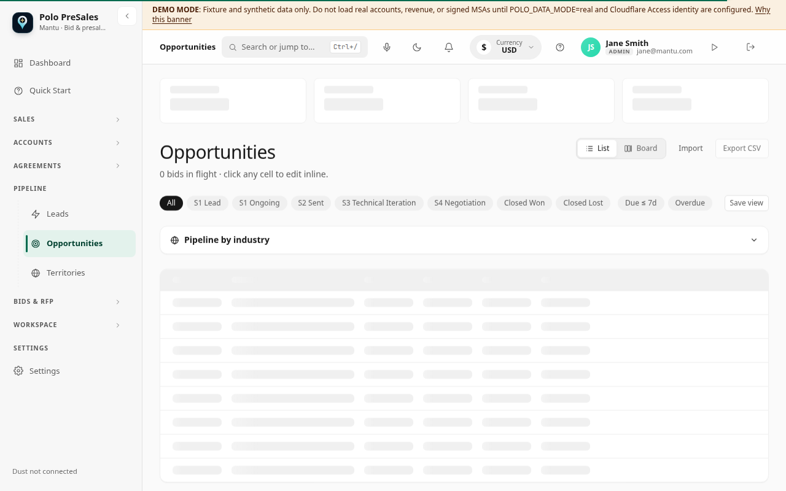

Fixed in #437, stacked on #366, head `fa2b8b54186a3d92bf531fe44344d5dd97bd2614`. The count is rendered only after a successful load. A real empty book still says `0 bids in flight`.

### 6. Medium — two submits create twice

Create company disables only after the next render. Two submits in that turn both call `onCreate`. The typed name is kept when the request fails, which is what we want.

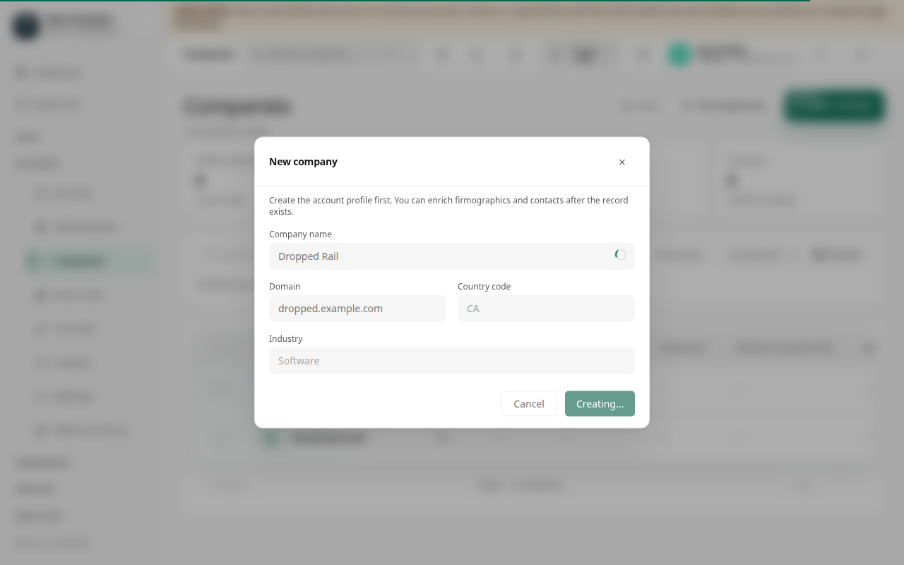

Fixed in #438, from `main`, head `28ae0b15284da8e3f56fc10bd35381bd0f3a37eb`. The dialog arms a ref on the first submit and clears it when `isPending` returns to false.

A dropped `POST` is status 0 in the client. #431 maps that to `toast.networkError` (`Network error. Check your connection.`) instead of `Failed to fetch`.

## Checked, not filed

| Check | Result |
| --- | --- |
| Integrations unset (no Dust key, no HubSpot token) | Settings → Integrations says Needs setup. Dust is `Unverified / not connected`. HubSpot says `Never synced`. No env var name and no stack. |
| Worker killed after a 2-row CSV import | The job was already `COMPLETE` (2 processed, 0 errors) before the signal. Restart did not insert the rows again. Companies were Northwind Labs, Contoso Rail, plus the two synthetic rows from that import (`Fabrikam Signal`, `Adventure Works`, both `*.example.com`). A crash in the middle of a long chunk was not reproduced. The stale sweep still waits 15 minutes before it fails a running import that saved nothing. |
| 500 JSON that also contained a stack and `storageKey` | Neither string was in the visible accounts text. |
| Route 404 | Unchanged from sweep 05. Not this lens. |

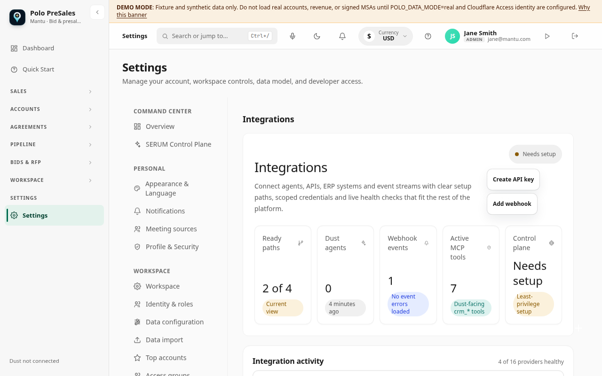

## Counts

| | |
| --- | --- |
| New | 6 |
| Fixed | 6 findings, in 6 draft pull requests. Finding 1 is #429 (API) and #431 (browser). |
| Duplicate | 0 new defects. #348, #349, #376, #389, and #400 were read and left as the owners of the adjacent work. |
| Open | The 15-minute stale import window if a worker dies before the first row commits. Contacts, leads, and tasks still use `error.message` for a safe server sentence, which #431 now translates when the sentence is compiler text. Other create dialogs do not have the double-submit ref. |

## Fix pull requests

| | PR | Head | Stack |
| --- | --- | --- | --- |
| Validation envelope | https://github.com/mysticalsin/bidstack-360/pull/429 | `6a166ec506dfe45bf7ca83fc00e1ef446e97e8c0` | on #348 |
| Translated sentences | https://github.com/mysticalsin/bidstack-360/pull/431 | `d1a26d8e9f5f63153c97a1f3f8dcd1e45df64065` | `main` |
| Unclosed CSV quote | https://github.com/mysticalsin/bidstack-360/pull/432 | `b1d67cc6d2ab9488f7e03b29c7f557351490fd63` | on #349 |
| 8 MB import cap | https://github.com/mysticalsin/bidstack-360/pull/434 | `13620922eed9761039dc77688976bc6dc36317ce` | on #432 |
| Empty count while loading or failed | https://github.com/mysticalsin/bidstack-360/pull/437 | `fa2b8b54186a3d92bf531fe44344d5dd97bd2614` | on #366 |
| One company create per turn | https://github.com/mysticalsin/bidstack-360/pull/438 | `28ae0b15284da8e3f56fc10bd35381bd0f3a37eb` | `main` |

All six are drafts.
