# Sweep 09 — empty, large, and edge data

Lens: a brand-new org, a synthetic book that does not fit on one page, and amounts and dates at the edges. Three orgs, every routed page, two viewports.

Date: 2026-11-21. Base: `main` at `40b13242` (merge of #70).

No Clerk key, no Dust key, no deploy, no polo-preview, no R2. `POLO_DATA_MODE=demo`. API `http://127.0.0.1:4000`, web `http://127.0.0.1:38081`. Browser: system Chrome via Playwright, viewports 1280×800 and 390×844. The org was selected with the existing dev header `x-bidstack-e2e-org` (`BIDSTACK_ALLOW_STUB_ORG_HEADER=true`). That header is not sent by the product. One side effect of the harness: the map tiles request to jsDelivr also carried the header and failed CORS. That is not a product bug.

## How the orgs were built

`pnpm db:seed:sweep09` (`packages/db/scripts/seed-sweep-09.ts`). Dev only. It refuses `NODE_ENV=production` and `POLO_DATA_MODE=real`. No new dependencies: Prisma for the tenant shell, `psql` `COPY` for the rows.

| Org | Clerk id | What is in it |
| --- | --- | --- |
| Sweep 09 Empty | `org_sweep09_empty` | Admin, roles, USD. Zero companies, opportunities, tasks. |
| Sweep 09 Huge | `org_sweep09_huge` | 20,000 accounts, 50,000 opportunities, 100,000 tasks. Names of 220 characters, emoji, Arabic, Hebrew, Cyrillic, Chinese, Japanese. Amounts of 0, −1.50, −9,000,000, 1 micro, up to 50,000,000,000,000. Due dates null, year 0001, 2020, today, 2027, and 9999-12-31. |
| Sweep 09 Mixed currencies | `org_sweep09_fx` | 8 accounts, 40 opportunities. Filings in USD, EUR, GBP, CHF, JPY, CAD, including 0 and −1,000 revenue. Org currency CAD. Opportunities still have no currency column. |

The huge org's open book is 35,713 deals and 2,123,937,912,080.68 (currency not recorded). Won this UTC year, after the close-date trigger stamped `closed_at` on insert, is 412,990,241,967.69. Overdue tasks: 21,000 of 100,000. Tasks still open: 75,000.

Sweep Sentinel (`3e99d956-fdfd-4658-85b8-2e2e4b8fe9c6`) is the account used for revenue, margin, and open jobs. Filed FY2024 revenue is 1,700,000,000 EUR, operating margin 18% (19.1% the year before). Four job postings were seen in the last 45 days. `GET /api/v1/accounts/{id}/key-numbers` returned those four figures: revenue 1700000000 EUR, margin 18, open jobs 4, open pipeline 1,000,000. That read was already right and was not changed.

## What was walked

38 routes on each org, at both sizes. 228 loads. Every one returned HTTP 200 from the document. No page text contained `NaN`, `Infinity`, or `∞`. No document was wider than its viewport.

Routes: `/dashboard`, `/quick-start`, `/forecasts`, `/win-loss`, `/sales-toolkits`, `/accounts`, `/accounts?view=key`, `/accounts?view=top`, `/kam`, `/companies`, `/sector-view`, `/cross-sell`, `/contacts`, `/meetings`, `/references`, `/agreements`, `/agreements/whitespace`, `/leads`, `/opportunities`, `/pipeline`, `/territories`, `/bid-matrix`, `/proposals`, `/tasks`, `/workload`, `/calendar`, `/workflows`, `/settings/custom-objects`, `/intake`, `/analytics`, `/workspace/insights`, `/settings`, `/search`, `/calls`, `/dashboards`, `/reports/list`, `/service-desk`, `/audit-log`.

Load time is navigation start through `networkidle` (capped at 12s) on the Vite dev server, after the first compile. It is not a production measurement.

| Org | Viewport | Median | p95 | Slowest |
| --- | --- | --- | --- | --- |
| Empty | 1280×800 | 816 ms | 998 ms | `/dashboard` 2,284 ms |
| Empty | 390×844 | 781 ms | 881 ms | `/dashboard` 1,117 ms |
| Huge | 1280×800 | 812 ms | 1,086 ms | `/workspace/insights` 1,844 ms |
| Huge | 390×844 | 810 ms | 1,203 ms | `/workspace/insights` 1,815 ms |
| Mixed | 1280×800 | 800 ms | 1,160 ms | `/dashboard` 1,335 ms |
| Mixed | 390×844 | 796 ms | 971 ms | `/dashboard` 1,284 ms |

Lists that paginate (companies, opportunities, tasks) stayed on one page of 50. The huge tasks page at 390×844 still laid out a year-0001 row. It did not overflow the screen. The badge on Tasks was 21,000, matching the overdue count. The badge on Opportunities was 35,713, matching the open count.

## Fixed

### 1. High — one credit or one oversized deal 500s every list that includes it

`Opportunity.value` was `nonnegative` and capped at 1,000,000,000,000. `CrmDeal.amountMicros`, won and lost values, and revenue-by-month were `nonnegative` integers. The database stores `value_micros` as bigint with no such cap. The mixed-currency org has a −2.50 deal and a deal of about 9.01 billion. `GET /api/v1/opportunities` returned 500 (`items[18].value` below 0). `GET /api/v1/crm/dashboard` returned 500 (`deals[1].amountMicros` below 0). The page drew skeletons and said "0 bids in flight" while the nav badge said 30. The same 500 fired on the huge org as soon as a cursor walked onto a negative or out-of-cap row, which took down sector view and CRM insights.

Reads now accept any finite amount, including a credit. Create and patch still refuse a negative or an amount over the write cap.

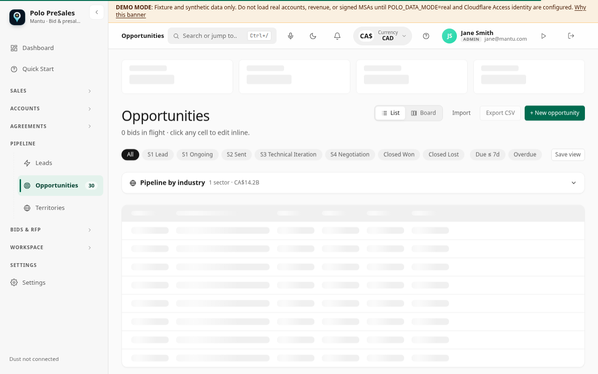

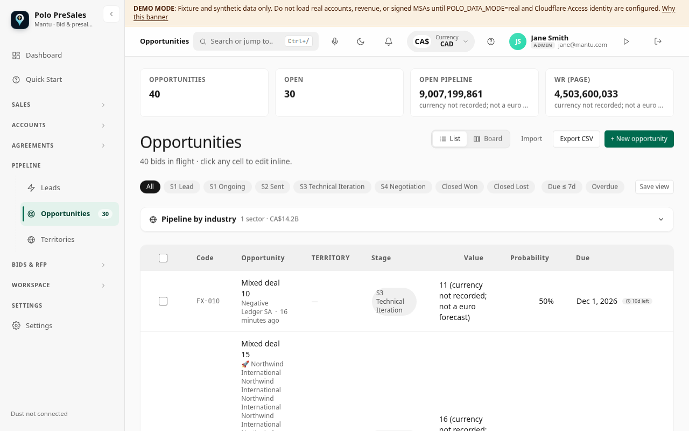

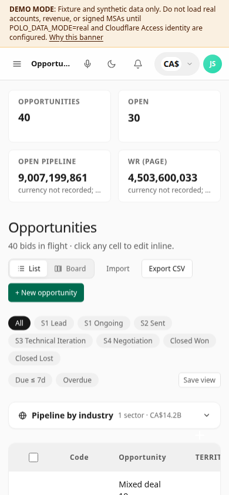

- PR: https://github.com/mysticalsin/bidstack-360/pull/450
- Head: `1dfe118836dfd5f1910b1e277334a8853afdfb3a`
- Tests: `packages/shared/src/schemas/opportunity.test.ts` (a credit and 50 trillion read; create still rejects both).

### 2. High — an empty org was given a Mantu account

`buildCompanies` appended Mantu whenever the org did not already have that name, with 12,000 employees and 1,000,000,000,000,000 micros of revenue. Accounts then said "1 company", 67% coverage, and one account at risk. Companies, which reads the company table, correctly said 0 and offered Add company and a CSV import.

The list is now only real companies. With none, the cockpit subject is an empty workspace: no headcount, no revenue, and it is not added to the list.

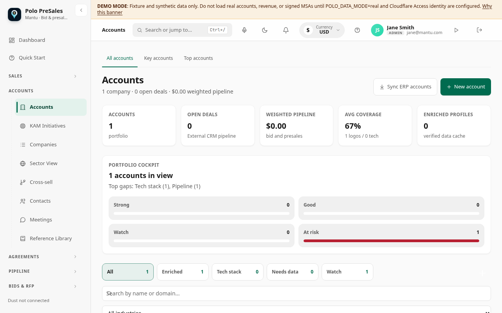

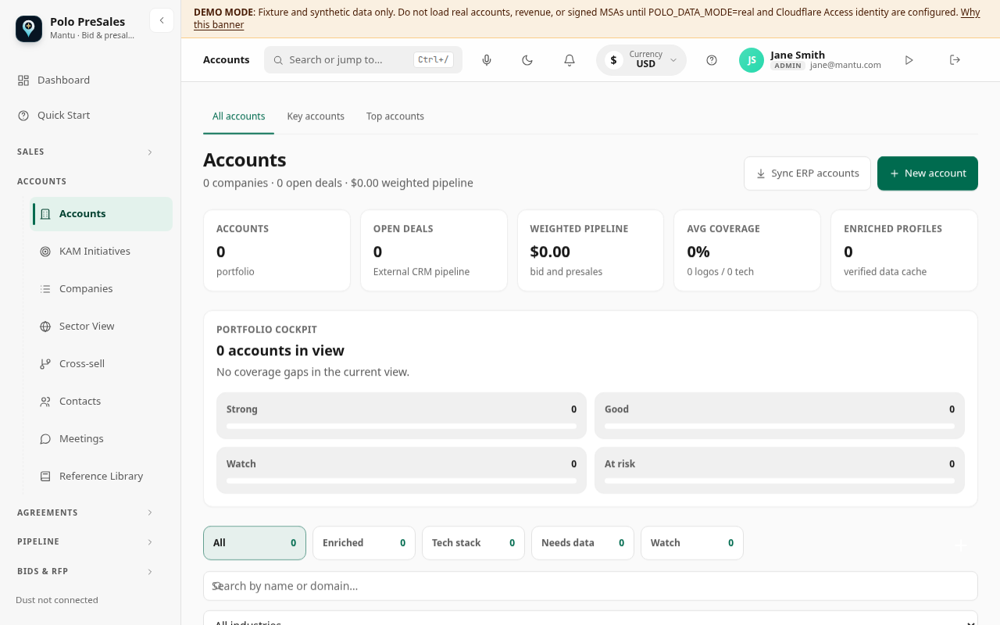

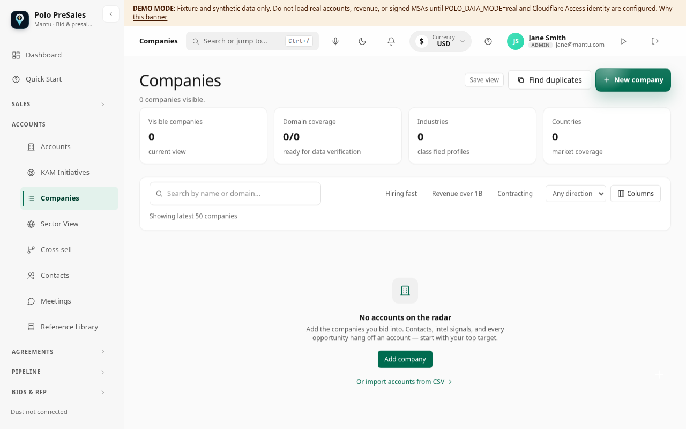

The org dashboard was already a useful empty state at both sizes: "Let's pilot your first bid", with Add an account, Open an opportunity, and Run the matrix.

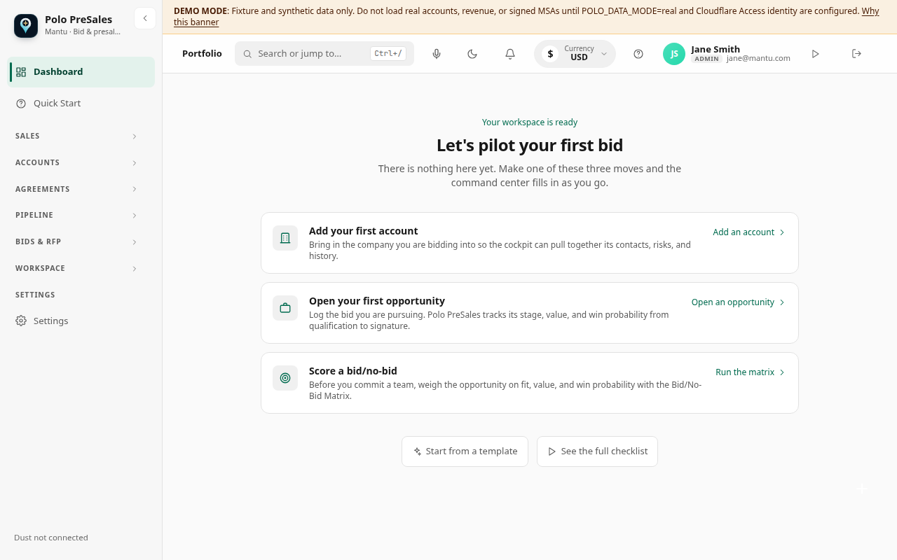

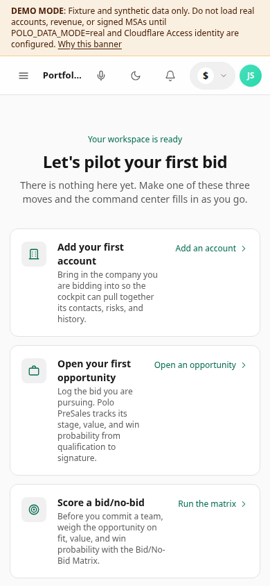

- PR: https://github.com/mysticalsin/bidstack-360/pull/451
- Head: `d16f52cce9f069a1c2ef0b4ae0dccf7634502927`
- Tests: `apps/api/src/services/crm/company-enrichment.mantu.test.ts` (Acme stays the only row; an empty input stays empty; the placeholder has null revenue and null headcount).

### 3. High — All accounts presented a 100-row sample as the portfolio

The All accounts view is the dashboard snapshot (latest 100 opportunities, enrichments capped at 200). The "this is not the full book" notice only appeared at 200 rows. The huge org loaded 100 companies (101 while Mantu was injected) and the page said "101 companies" and a €1.4K weighted pipeline, with no notice, against 20,000 companies and a 2.1tn open book.

When the org summary count is higher than the rows on screen, the header says "100 of 20000 companies" and the notice says the same. A small org whose snapshot matches the table is not warned.

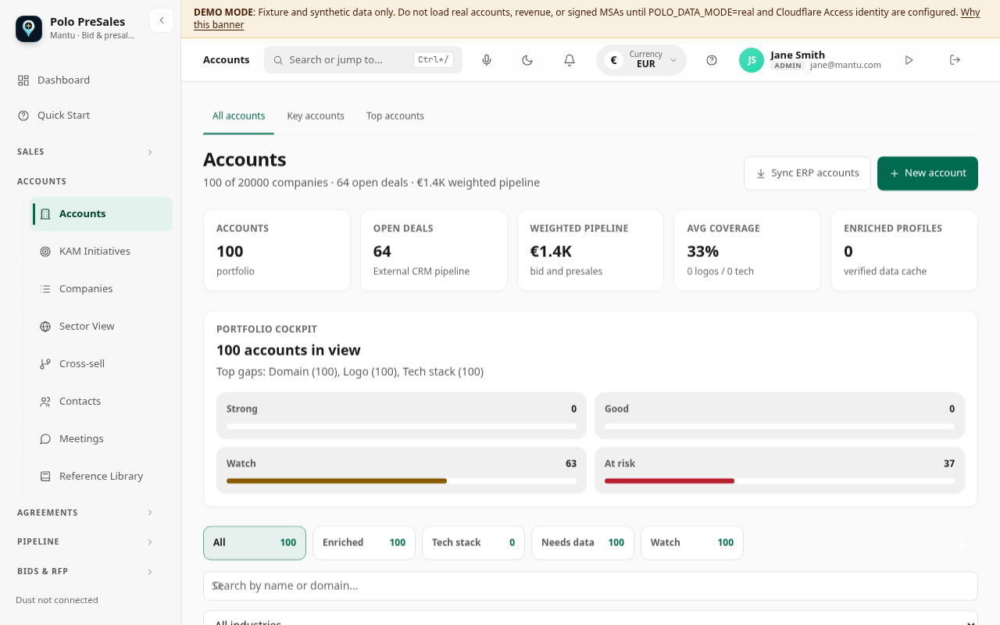

The €1.4K on that line is still the weighted pipeline of the loaded rows, and it is still labelled in the header currency. That labelling is #374. This change only stops the count from pretending to be the whole portfolio.

- PR: https://github.com/mysticalsin/bidstack-360/pull/452
- Head: `4d4b031304e0d629bd4691b6eb3089c29b510cd4`
- Tests: `apps/web/src/pages/accountsPage/AccountsAllSegment.snapshotCap.test.tsx` (100 rows against an org of 20,000 warns; 5 of 5 does not; the 200-row ceiling still warns).

### 4. High — "Won this year" was the latest 100 rows

Open pipeline on the hero comes from `GET /api/v1/reports/pipeline` and was the full 2.1tn (35,713 deals). Won this year was `cumulativeWon` of `useOpportunityRows`, which loads 100 opportunities. The screenshots show a three-digit figure. The closed book for the current UTC year is 412,990,241,967.69.

The summary now sums `closed_won` rows whose close (`closed_at`, or `due_date` when close was never recorded) falls in the current UTC year, in integer micros, and the hero uses that total. The same conversion replaces `Number(sum) / 1e6` for the summary pipeline value. After the change the hero reads 413bn, which is that total in compact form, and the API returns 412990241967.68695.

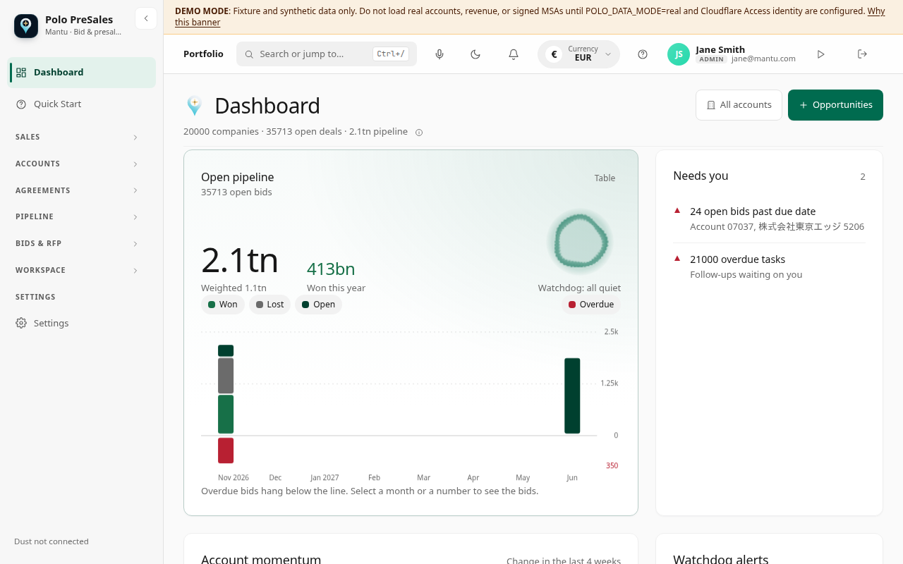

- PR: https://github.com/mysticalsin/bidstack-360/pull/453
- Head: `baa28fb29ca0c79937c531adbeb6020e4e57ccfd`
- Tests: `apps/api/src/routes/crm/summary.units.test.ts` (a sum past `2^53` micros is not `Number(bigint) / 1e6`). `summary.test.ts` (a win dated this UTC year counts, a win dated last year does not, an open deal stays in the pipeline). `DashboardHero.test.tsx` (a supplied org total replaces the rows on screen).

The four fix branches do not edit the same files. They are separate drafts from `main`, not a stack.

## Covered

| # | What this sweep saw | Where it already lives |
| --- | --- | --- |
| 5 | Weighted pipeline is a float product (`1.1tn` on the huge org). 1% of 1.50 becomes 0.02. | #396 |
| 6 | "Closed this quarter" follows `updatedAt` and a UTC quarter. Every huge-org win was inserted today, so the count matched the book for this seed and does not prove the quarter rule. | #384 |
| 7 | Amounts with no currency of their own are still summed, and the accounts sample money is labelled with the header currency (EUR on the huge org, CAD on the industry strip). The opportunities tiles do say "currency not recorded; not a euro forecast". | #374, and #64 for a missing amount labelled as dollars |
| 8 | Filtered opportunity totals, the 500-deal account sample, and a live lost stage. | #378, #357, #380, #381, #382 |
| 9 | Tasks badge versus the Tasks page, and a date-only due day west of UTC. The badge here matched the overdue SQL count (21,000). | #375 |

## Recorded, not changed

### 10. Medium — some empty states have no next step

These have a sentence and no button. The sentence says where the data will come from, which is enough to understand the page and not enough to start:

| Page | Title |
| --- | --- |
| Forecasts | No open pipeline to forecast |
| Win/Loss | No closed bids in this range yet |
| Sales toolkits | No stored toolkits yet |
| Sector view | No sector data yet |
| Cross-sell | No cross-sell actions |
| Territories map | No geographic data |
| Calls | No calls found |

These have a title and nothing else:

| Page | Title |
| --- | --- |
| Territories | No territories |
| Territories | No routing rules |
| Service desk | No cases yet |

Search says to type in the box above it. That is the next action.

Win/Loss stays empty on the huge org even though 7,145 deals are `closed_won`. The page is the reason log, not the stage column. The copy says outcomes appear once a reason is recorded. No reasons were seeded. Not changed.

### 11. Low — a year-0001 due date reads as 739,940 days late

The huge tasks list orders by due date, so year 0001 is the first page. The phone layout holds. The chip says `Overdue: 739940d late`. The date is real. The chip is not a useful way to say it.

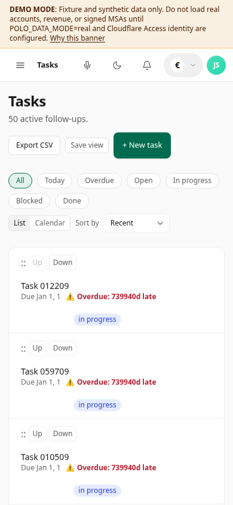

### 12. Low — the monthly chart under the hero is still the latest 100 bids

The won-this-year figure is now the full year. The bars beside it are still `pipelineByCloseMonth` of those 100 rows. They are not labelled as a sample. Not changed in this sweep.

## Counts

| | |
| --- | --- |
| Pages loaded | 228 (38 routes × 3 orgs × 2 viewports) |
| Document errors | 0 |
| `NaN` / `Infinity` on screen | 0 |
| Horizontal overflow | 0 |
| API 500s before the read-schema fix | 20 page loads, all `GET /opportunities` or `GET /crm/dashboard` once a negative or out-of-cap amount was in the page |
| Red findings fixed | 4 |
| Red findings left | 0 |
| Recorded, not changed | 3 (empty-state actions, ancient-date chip, sample chart) |
| Duplicates of open PRs | 5 topics, listed above |
