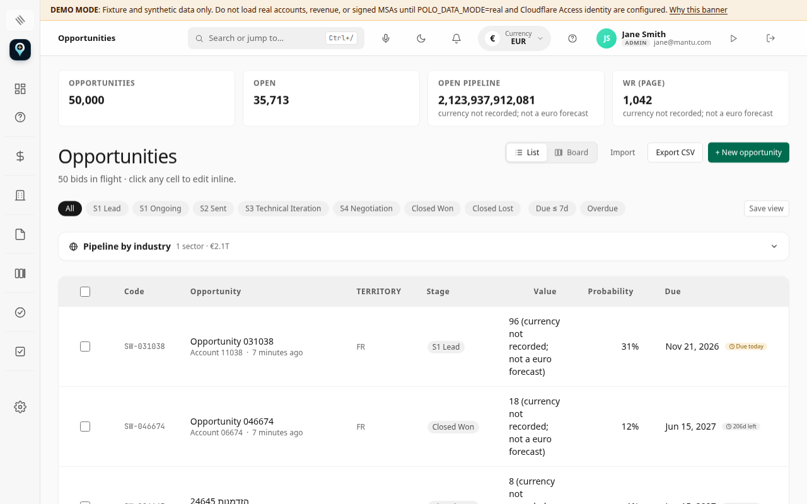
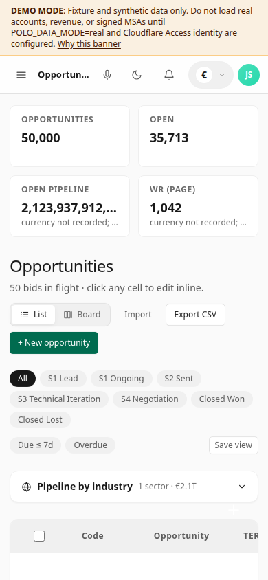
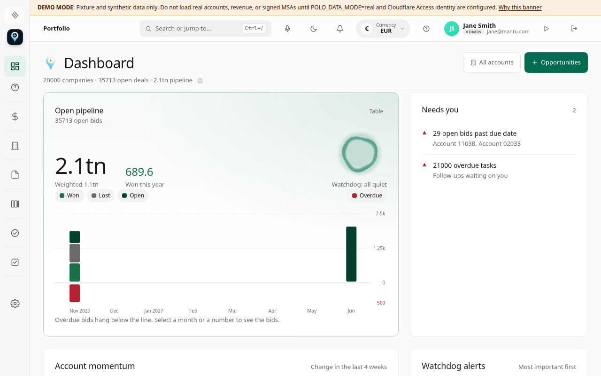
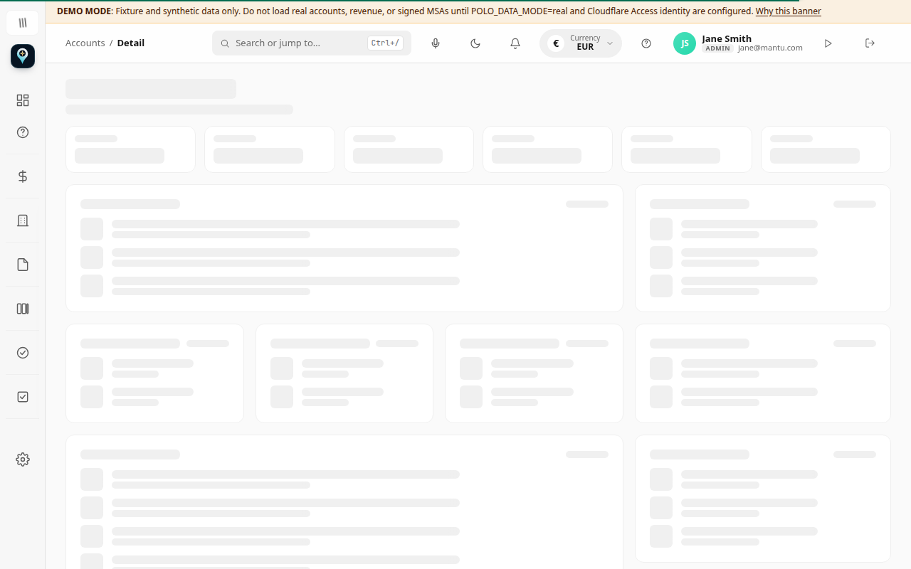
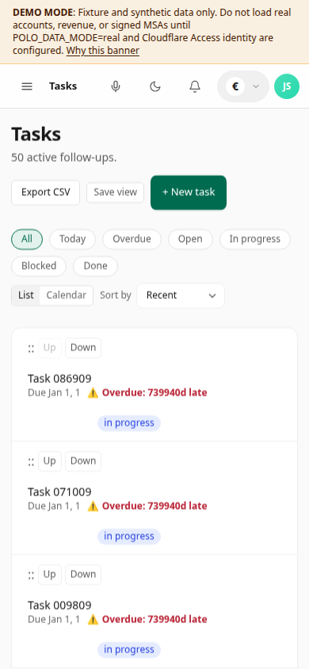
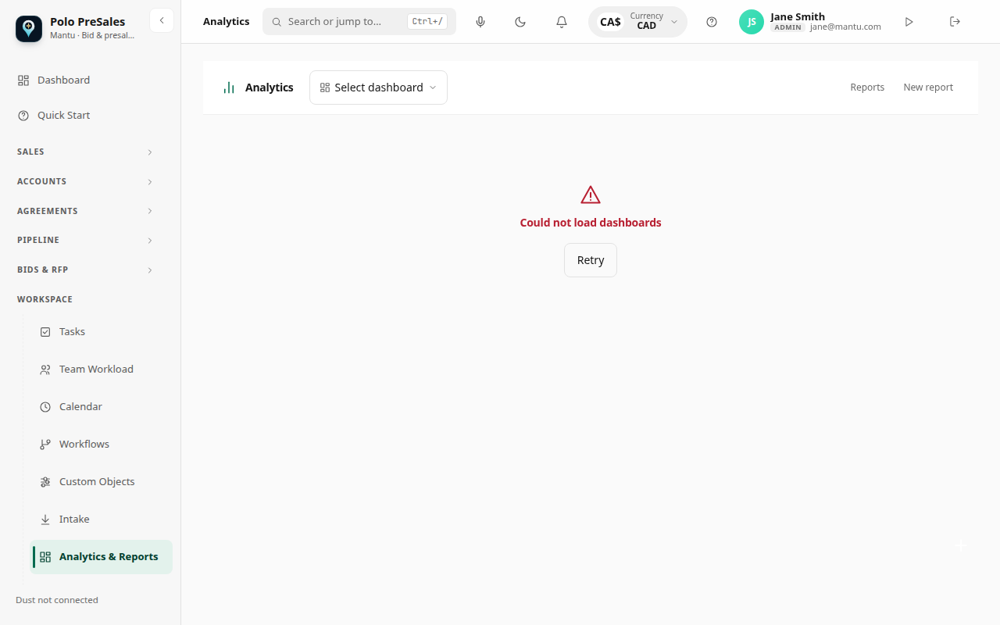

# Sweep 11 — performance

Physical pass on current `main` (`40b13242`) with a local stack and synthetic data only. No Clerk key, no paid API, no deploy. `polo-preview`, Cloudflare, and R2 were not touched.

Postgres 16.15 with pgvector 0.6.0, Redis 7.0.15, the API on port 4000, the worker, and a production build of the web app served by Vite preview. Docker is not installed on this machine, so the processes ran directly. The same note is on the stress sweep (#410).

The org is the sweep 09 generator (`packages/db/scripts/seed-sweep-09.ts` on draft #456, `pnpm db:seed:sweep09`). It refuses production and real mode. Counts: 20,000 accounts, 50,000 opportunities, 100,000 tasks. Users are `sweep09-*@bidstack.test`. Companies are fictional (Sweep Sentinel and generated names). The huge org id is `8798740a-dc92-42ac-9181-0a11571de954` (`org_sweep09_huge`). The API stub session was pointed at that org with `BIDSTACK_STUB_ORG_CLERK`.

## Severity

| | Severity | What | Result |
| --- | --- | --- | --- |
| 1 | High | The shell statically imports the recharts chunk (123 KB gzip) because `d3-sankey` in vendor imports `d3-shape` in charts. Rollup: `Circular chunk: charts -> vendor -> charts`. | Fixed in #465. Initial JS 571 KB → 446 KB gzip. |
| 2 | High | `GET /opportunities?search=` seq-scans every deal. The expression GIN index only matches `GET /search`. 50,037 rows removed, 50.4 ms, for 3 hits. | Fixed in #466. Same predicate 0.14 ms. |
| 3 | High | The Sweep Sentinel cockpit returns 500. One stored credit or oversized amount fails the dashboard schema. The page stays on the loading skeleton. | Duplicate of #450. Not redone. |
| 4 | Medium | Account name search seq-scans 20,000 companies. 8.4 ms, 20,007 rows removed, for one hit. Contacts, leads, and tasks already have trigram indexes. | Fixed in #467. Same predicate 0.10 ms. |
| 5 | Low | `GET /accounts/top` hashes every opportunity to rank 20 companies. p95 112 ms. SQL 35 ms. A seq scan is the right plan: every row qualifies. | Recorded. No index removes that read. |

Counts: **3 high** (2 fixed, 1 duplicate), **1 medium** (fixed), **1 low** (recorded).

## Already open, not redone

| | Why it is not a new finding |
| --- | --- |
| #450 | The list and the cockpit 500 on a credit or an oversized deal. `GET /opportunities?search=Sentinel` also 500s for that reason (p95 5 ms, the schema fails before the scan matters). |
| #386 | Win/loss totals stop at 1,000 rows. `GET /api/win-loss/analysis` was fast here (p95 5.4 ms) because it never reads the rest of the book. |
| #411 | The CSV enqueue test polls for one second. That is a test timeout, not a request path. |
| #410 | Stress sweep: concurrency, soak, and failure injection. It did not explain the large-org search plans. |
| #452, #453 | Sweep 09. All accounts is a 100-row sample. Won this year is the latest 100 rows. |
| #396 | Weighted pipeline is a `float8` product. The pipeline aggregate below is that query. The float is the open money work. |

## Browser

Headless Chrome at 1280×800 and 390×844, production preview, warm navigation (`networkidle` after one load). LCP is from a buffered `largest-contentful-paint` observer. Click-to-paint is two animation frames after a real click in the page. No long task of 50 ms or more on any of these loads.

| Page | Viewport | LCP ms | FCP ms | nav idle ms | click-to-paint ms |
| --- | --- | --- | --- | --- | --- |
| dashboard | 1280×800 | 136 | 72 | 859 | 81 |
| accounts | 1280×800 | 112 | 28 | 749 | 26 |
| opportunities | 1280×800 | 116 | 36 | 738 | 26 |
| pipeline | 1280×800 | 120 | 28 | 761 | 20 |
| tasks | 1280×800 | 124 | 28 | 789 | 20 |
| analytics | 1280×800 | 120 | 32 | 718 | 12 |
| customer `/accounts/:id` | 1280×800 | 136 | 64 | 810 | 23 |
| company `/companies/:id` | 1280×800 | 120 | 64 | 753 | 19 |
| dashboard | 390×844 | 128 | 56 | 848 | 23 |
| accounts | 390×844 | 124 | 32 | 771 | 18 |
| opportunities | 390×844 | 128 | 32 | 763 | 17 |
| pipeline | 390×844 | 112 | 28 | 756 | 16 |
| tasks | 390×844 | 112 | 32 | 741 | 15 |
| analytics | 390×844 | 124 | 36 | 723 | 8 |
| customer | 390×844 | 128 | 68 | 817 | 32 |
| company | 390×844 | 120 | 24 | 767 | 11 |

Localhost transfer makes LCP small. The byte cost is in the bundle section. The customer route never painted a company name: the cockpit request 500s (#450) and the capture is still the skeleton.

## Bundle

Production build, gzip level 9. No chunk exceeds the existing 250 KB gzip budget. The initial graph was 571 KB gzip, under the 800 KB budget, and 123 KB of it was charts on every route.

| Chunk | Before gzip | After gzip | On the shell before | On the shell after |
| --- | --- | --- | --- | --- |
| index | 121 KB | 121 KB | yes | yes |
| charts (recharts) | 123 KB | 128 KB | yes | no |
| vendor | 119 KB | 118 KB | yes | yes |
| motion | 88 KB | 88 KB | yes | yes |
| editor | 130 KB | 134 KB | no | no |
| SettingsPage | 107 KB | 110 KB | no | no |
| DashboardPage | 101 KB | 104 KB | no | no |
| Initial graph | 571 KB | 446 KB | | |

Route chunks, gzip, before the split (they did not move): Accounts 13 KB, Opportunities 9 KB, Pipeline 5 KB, Tasks 7 KB, Analytics 5 KB, Company detail 17 KB. DashboardPage is the customer cockpit as well as the home dashboard, 101 KB, and it loads only when that route does.

## API

Fifteen samples after two warmups, stub auth, huge org. Times are the full HTTP round trip.

| Endpoint | Status | p50 ms | p95 ms |
| --- | --- | --- | --- |
| `GET /api/accounts/top?limit=20` | 200 | 92.5 | 112.1 |
| `GET /api/portfolio/momentum?limit=20` | 200 | 47.6 | 57.6 |
| `GET /api/duplicates/companies` | 200 | 38.7 | 42.6 |
| `GET /api/reports/pipeline` | 200 | 40.0 | 41.5 |
| `GET /api/forecasts/projection` | 200 | 34.7 | 36.7 |
| `GET /api/tasks/summary` | 200 | 25.4 | 34.7 |
| `GET /api/accounts/industries` | 200 | 26.7 | 29.0 |
| `GET /api/companies?search=Account&limit=20` | 200 | 25.1 | 28.3 |
| `GET /api/analytics/workload` | 200 | 19.8 | 25.5 |
| `GET /api/reports/tasks` | 200 | 16.0 | 23.7 |
| `GET /api/territories/analytics` | 200 | 21.9 | 23.4 |
| `GET /api/search?q=Sentinel` | 200 | 22.1 | 23.2 |
| `GET /api/companies?limit=50` | 200 | 17.0 | 21.1 |
| `GET /api/watchdog/feed?days=30` | 200 | 15.1 | 16.1 |
| `GET /api/crm/dashboard` | 200 | 10.8 | 12.7 |
| `GET /api/tasks?limit=50` | 200 | 6.7 | 11.6 |
| `GET /api/companies/:sentinel` | 200 | 10.1 | 10.9 |
| `GET /api/crm/dashboard?account=:sentinel` | 500 | 7.2 | 8.8 |
| `GET /api/opportunities?limit=50` | 200 | 6.1 | 7.5 |
| `GET /api/crm/summary` | 200 | 5.9 | 7.0 |
| `GET /api/pipeline-stages` | 200 | 6.2 | 7.1 |
| `GET /api/win-loss/analysis` | 200 | 4.8 | 5.4 |
| `GET /api/opportunities?search=Sentinel&limit=20` | 500 | 4.2 | 5.0 |
| `GET /api/opportunities/count` | 200 | 4.1 | 5.1 |

`GET /api/search?q=Sentinel` is 23 ms and returns 200. It already uses the concatenated expression index. The list search does not. After #466, `search=Opportunity 000010` went from 109 ms to 5 ms warm. After #467, `search=Sweep Sentinel` on companies went from 26 ms to 8 ms warm.

`GET /api/msa/search?q=a` and `GET /api/infosearch/leads` returned 400. They want a longer query or a required parameter. They are not slow.

## EXPLAIN ANALYZE

Org `8798740a-dc92-42ac-9181-0a11571de954`.

| Query | Before | After |
| --- | --- | --- |
| Opportunity list search `%Sentinel%` | Seq Scan, 50.4 ms, 1,408 buffers, 50,037 rows removed | Bitmap index scan on `opps_list_search_trgm_idx`, 0.14 ms, 3 heap blocks |
| Company name `%Sentinel%` | Seq Scan, 8.4 ms, 417 buffers, 20,007 rows removed | Bitmap index scan on `companies_search_trgm_idx`, 0.10 ms, 1 heap block |
| Opportunity list default sort, limit 51 | Index Only Scan on `opps_org_list_sort_idx`, 0.03 ms | unchanged |
| Top accounts (sum of every deal, limit 20) | Hash join + hash aggregate, Seq Scan of both tables, 35.5 ms | not changed |
| Open pipeline weighted sum | Seq Scan, 16.0 ms, 35,713 open rows of 50,000 | not changed. Most rows qualify, so the scan is the plan |
| Task counts by status | Seq Scan, 16.9 ms, 100,000 rows | not changed. The aggregate reads every task |

Portfolio momentum's company filter is a nested loop on `companies_org_id_name_unique` and `opportunities_company_id_idx`, 0.23 ms. The 58 ms HTTP time is the follow-up reads for the 20 accounts, each capped at 1,000 rows. No N+1 in that query.

The default opportunity list is one indexed page plus a comment `groupBy` for those ids. It is not a per-row query.

## Worker

The worker was restarted by `tsx watch` when files changed, so the first process (pid 7373) is not a clean ten minutes. RSS on that process: 341 MB at start, 319 MB after the first scheduled scans, then 245–247 MB until the watch restart.

A clean window on pid 9315, 2026-11-21T04:20:09Z to 04:30:09Z:

| | RSS |
| --- | --- |
| 04:20:09 | 312 MB |
| 04:21:09 | 242 MB |
| 04:25:09 | 249 MB |
| 04:30:09 | 249 MB |

After the first minute the process stayed between 242 MB and 251 MB. It did not climb at the end of the window. Redis stayed at 3.3 MB used, peak 5.5 MB.

Completed jobs in that window: 44 (207 → 251). They are the repeatable scanners, not a backlog: agreement-ingest 10, dust-poll 8, calendar pull 5, migration stale scan 10, crew and RFP reapers 2 each, tenant-export sweeper 2, workflow schedule 1. Failed, waiting, and active counts were 0 at the end. 36 delayed jobs are the next repeatable ticks, one per queue. The hourly task and bid-deadline scans had already run on boot; they did not run again inside this ten minutes, and they did not keep the RSS high.
