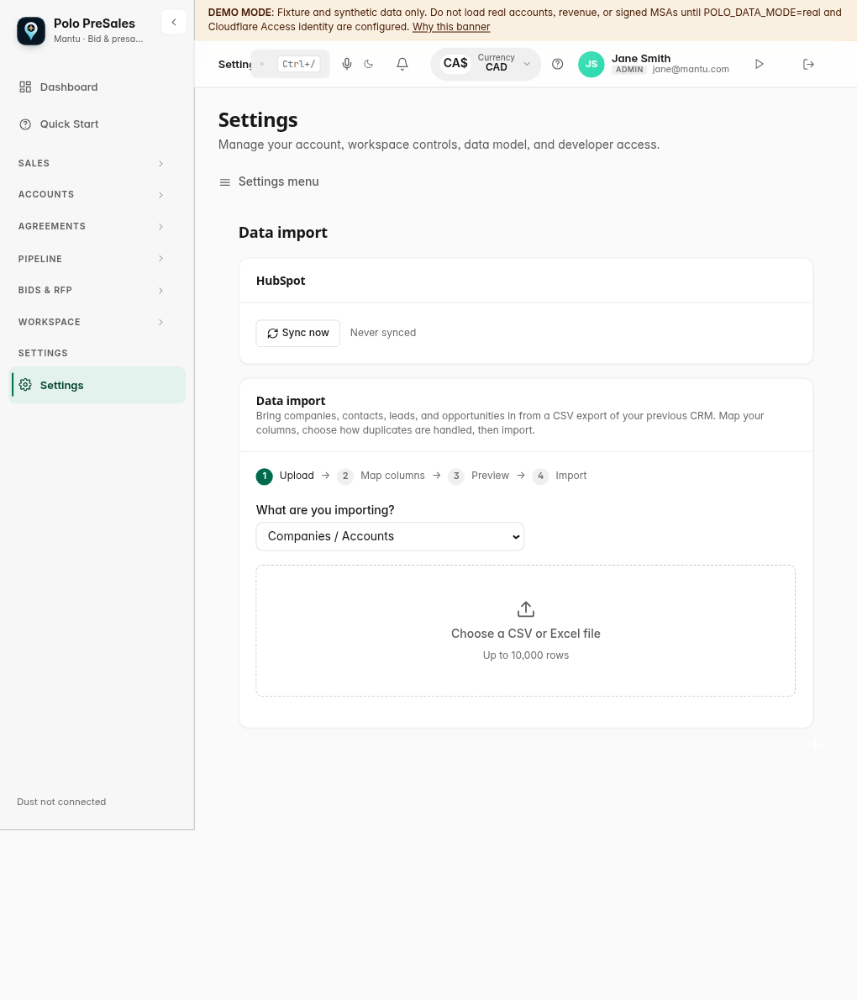
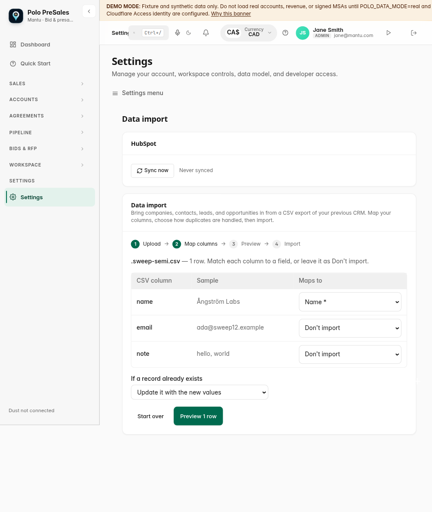
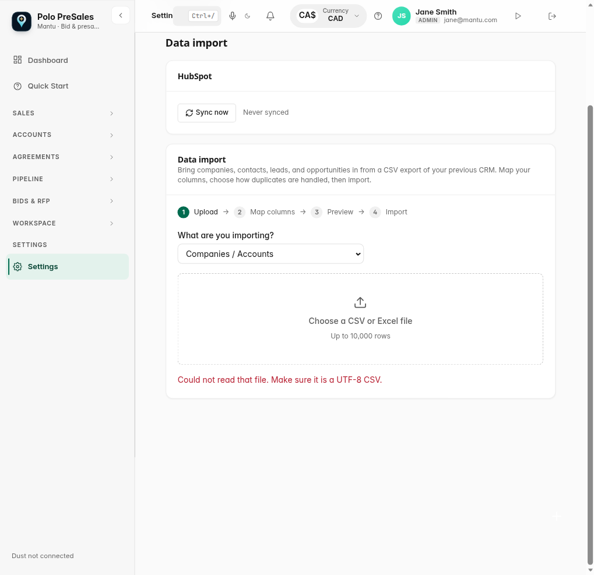

# Sweep 12 — import and export round-trip

Lens: export every exportable entity, import that file into an empty book, and diff the fields. Encoding, a UTF-8 BOM, emoji, RTL and non-Latin names, commas, quotes and newlines, formula cells (`= + - @`), dates and time zones, currency and decimal precision, empty versus null. Also a malformed file, a 50 MB body, a duplicate-heavy file, the wrong delimiter, cancel and undo, running the same import twice, two imports at once, and whether a member can start, cancel, or undo.

Date: 2026-11-21. Base: `main` at `40b13242ebf18d715b67bb6133a9774bbd7d0c78`.

Synthetic only. PostgreSQL 16.15 with pgvector 0.6 on `127.0.0.1:5432`, Redis 7 on `127.0.0.1:6379`, API `127.0.0.1:4000`, worker, Vite `http://127.0.0.1:38081`. No Clerk key, no Dust key, no deploy, no polo-preview, no R2. The browser is Playwright Chromium. The org under test is the local seed org, and every row this sweep wrote is named `Sweep12…` or `Ångström`.

## Severity

| # | Severity | Finding | Status |
| --- | --- | --- | --- |
| 1 | High | `1.234,56` is stored as 1.23456, `(1,234.50)` becomes a profit, and `n/a` becomes 0. A filed loss is rejected by preview. | Fixed |
| 2 | High | `2026-03-15T00:00:00+05:00` is stored as 14 March | Fixed, stacked on 1 |
| 3 | High | This app's own CSV headers do not map, `50%` is stored as 0, and a spreadsheet apostrophe sticks | Fixed, stacked on 2, with the header aliases stacked on #432 |
| 4 | High | `OP-H10` mints `OP-0NaN`. The next row fails, and the error file hides the reason | Fixed, stacked on 3 |
| 5 | Medium | A negative amount is prefixed like a formula, so Excel stores text | Fixed, from `main` |
| 6 | Medium | A semicolon or tab file is one column | Fixed, stacked on the alias PR, which is stacked on #432 |
| 7 | — | Members can start, cancel, and undo | Duplicate of #383. Verified 403 on this stack |
| 8 | — | Redis rows left behind on a lost claim or a cancel | Duplicate of #350 and #412 |
| 9 | — | Company create hangs when Redis is down | Duplicate of #376. Not re-filed |
| 10 | — | An unclosed quote is swallowed into one cell | Duplicate of #432. The wizard now says the file could not be read |
| 11 | — | No browser cap before an oversized CSV is parsed | Duplicate of #434 |
| 12 | — | A body over 10 MB is `FastifyError` / `Request body is too large` | Duplicate of #429 |
| 13 | — | Org-chart and audit CSV formula cells | Duplicate of #385 |
| 14 | — | A date-only value renders as the previous day west of UTC | Duplicate of #379. That is display. This sweep's date bug is the stored instant |

## What held

These were exercised on the live API and worker with synthetic rows.

| Check | Result |
| --- | --- |
| Emoji, Arabic, quotes, and a newline inside a field | Stored as written: `Sweep12 Ångström`, `مختبر سويب`, `Sweep12 "Quotes", Inc`, industry `line` + newline + `break`. |
| Employee `1,234` and country `QA` | 1234 and `QA` when the columns are mapped. |
| Empty cell versus null | An empty domain, industry, and country are stored null. A blank cell does not become the string `"null"`. |
| UTF-8 BOM on the first header | `String.trim` already drops U+FEFF. A regression test locks that. |
| Same import twice (`dedupStrategy: update`) | One opportunity row. The second run updated the value, probability, and due date. |
| Two different company imports at once | Both returned 201 and `RUNNING`. |
| The same file twice at once | One 201 and one 409 `This import is already running.` |
| Member start, cancel, and undo | Account Executive and Presales received 403 `Requires permission: settings:write`. No job was created by the member start. |
| 50 MB and 11 MB JSON bodies | 413 `{"error":"FastifyError","message":"Request body is too large"}`. The cap is `bodyLimit: 10485760` in `apps/api/src/server.ts`. The wording is #429. The browser still parses a large CSV before upload; that cap is #434. |
| Tasks, service desk, leads, companies, contacts | Client CSV via `downloadCsv`. Reports export CSV and JSON. Opportunities stream from `GET /api/v1/opportunities/export`. Financial periods have an importer and no CSV export on the account page. The tenant archive does not include `accountFinancialPeriod`. Noted, not changed. |
| Formula text `="cmd"` | Stored as that text. The next export prefixes it. Re-import of the prefixed form is finding 3. |



## Fixed

### 1. High — spreadsheet amounts were not the amount in the cell

`asMicros` stripped every comma and then did `Number(text) * 1e6`.

On the live API, one opportunity row:

| Cell | Stored |
| --- | --- |
| Value `1.234,56` | `1.23456` |
| Probability `50%` | `0` (finding 3) |
| Close `2026-03-15T00:00:00+05:00` | `2026-03-14` (finding 2) |

`(1,234.50)` became `1234.50` because the parentheses were stripped with the other symbols, so a loss was stored as a profit. `n/a` on a deal became €0 (`?? 0n`). A trillion and one cent is already past what `Number` can round (`1000000000000.01` → `1000000000000009984` micros).

Preview rejected every negative, including operating income, with `money cannot be negative`, and the confirm button stays enabled. A careful user does not import the loss.

`parseImportMoney` splits the written digits and calls `unitsToMicros`. A comma with one or two trailing digits is the decimal separator. Parentheses are a sign. A deal amount that is not a number, is negative, or is over 1e12 is a row error. Financial lines may be signed. The preview uses the same parser.

- PR: https://github.com/mysticalsin/bidstack-360/pull/474
- Head: `882e189a5e6b7d200ec0aaeda3a5430ca9c28d2a`
- Red: `1.234,56` was `1234560n`, expected `1234560000n`, in `migration.helpers.test.ts`

### 2. High — an offset date was stored as the previous UTC day

`new Date('2026-03-15T00:00:00+05:00')` is `2026-03-14T19:00:00.000Z`. `@db.Date` then stores 14 March. The live row above did that. Close dates and period ends are the calendar day in the cell. `asDate` reads the year, month, and day from an ISO string or `MM/DD/YYYY` and stores that civil day at UTC midnight. `2026-02-31` is rejected.

Stacked on finding 1. Both edits are in `apps/worker/src/queues/migration.ts`. This branch starts at the money head. Main had not moved, so there is no merge commit.

- PR: https://github.com/mysticalsin/bidstack-360/pull/479
- Head: `fd9e21c2517a783b3488be80470640f57d3d5316`

### 3. High — a file this app exported did not import as the same book

The companies export writes `Employees`, `Country`, and `Legal Name`. The contacts export writes `Role` and `Customer`. The leads export writes one `Name` and `Company`. The opportunities export writes `Value (EUR)`, `50%`, and `Due date`.

`autoMap` only matched a label or a key tail. Employees, country, role, customer, value, and due date stayed unmapped. `Number('50%')` is `NaN`, so a mapped probability became 0, which the live row showed. `asTrimmed` kept the apostrophe that `csvCell` adds, so a re-import of `'+33…'` or `'=Acme` stored the apostrophe. `legalName` is a column and was not written. A lead name was never split.

#432 already maps `Employees`, `Country`, and `Account Name` in the same matcher. The rest of the headers are stacked on that branch so the two diffs do not both rewrite `autoMap`. The worker changes (percent, apostrophe, legal name, lead split) are stacked on finding 2.

| Piece | PR | Head |
| --- | --- | --- |
| Worker: `50%`, apostrophe, legal name, lead name | https://github.com/mysticalsin/bidstack-360/pull/481 | `8c0bad892b7b9f0404fcf7cf4d6d875ea8a6a4f7` |
| Wizard aliases | https://github.com/mysticalsin/bidstack-360/pull/476 | `0001fce16dd33599d40b7e3398401031ead9697b` |

#476 starts with a merge of #434 (`0001fce1`). #432 already had #434 above it, and GitHub stacks only grow at the top, so the aliases sit on #434. The matcher change itself is the commit on top of #432's head `b1d67cc6`.

### 4. High — `OP-H10` minted `OP-0NaN`

The seed book contains `OP-H01` … `OP-H10`. The worker's `mintNextCode` ordered codes lexicographically and did `Number('H10')`, which is `NaN`, then padded that to `OP-0NaN`. The first imported deal was stored with that code. The next valid row failed the unique `(org_id, code)` key five times, because every retry still saw `OP-H10` as the greatest code.

The error CSV did not show the Prisma text. It showed `The import could not be completed.` The missing-name row on the same file correctly said `opportunity.name is required`.

```
row,field,message
1,"","The import could not be completed."
2,"","opportunity.name is required"
```

The API helper in `opportunities.helpers.ts` already takes `MAX` of `code ~ '^OP-[0-9]+$'`. The worker copy had not been kept in sync. It now uses that query. If five collisions still happen, the row error is `Could not assign an opportunity code`, which the error file is allowed to show.

Stacked on finding 3's worker branch, again because both edit `migration.ts`. Linear history from that head.

- PR: https://github.com/mysticalsin/bidstack-360/pull/482
- Head: `057cb047cf51cf015c502b38c5e25565849a7abd`

#432 also edits `apps/worker/src/queues/migration.ts` (278 lines against `main`). Its `mintNextCode` is still the lexicographic copy. Merging both means keeping the numeric query.

### 5. Medium — a loss was text in the CSV

`csvCell` prefixed every leading `-`, `+`, `=`, `@`, tab, and carriage return. `-1.50` became `'-1.50`. Excel then stores text and `SUM` skips it. `-1+1` and `=SUM(A1)` still get the apostrophe.

The opportunity stream, the companies, contacts, leads, tasks, service desk, report, and widget exporters now share `spreadsheetCell` in `@bidstack/shared`. The audit and org-chart exporters are #385 and were not edited.

- PR: https://github.com/mysticalsin/bidstack-360/pull/475
- Head: `ffb70e76b551c8e446c85d912042ca113c637095`
- Red: `csvCell('-1.50')` was `'-1.50`

### 6. Medium — the wrong delimiter was one column

`parseCsv` split only on commas. A header `name;email` was one column. The red test received `['name;email']`.

The header line is counted outside quotes. The separator that appears most often wins. A tie stays a comma, which is what this app exports. Tabs are included. An unclosed quote still throws, which is #432.



The sample cell is `Ångström Labs`. The columns are `name`, `email`, and `note`, not one glued header.

Stacked on #476. Merge commit `3a870381` brings in the alias branch after it merged #434. #432 owns the unclosed-quote check in this parser.

- PR: https://github.com/mysticalsin/bidstack-360/pull/478
- Head: `3a87038155253159f07a67d1935e87de002c4405`



The sentence is `Could not read that file. Make sure it is a UTF-8 CSV.` The file was UTF-8. The failure was the quote. That copy is the wizard's existing `csvImport.error.unreadable`, which #432 already routes the throw to. Not changed here.

## Counts

| | |
| --- | --- |
| New | 6 |
| Fixed | 6, in 7 draft pull requests. Finding 3 is two pull requests because #432 already owns part of the matcher. |
| High | 4 |
| Medium | 2 |
| Low | 0 |
| Duplicate | 8 topics, the table above (#383, #350, #412, #376, #432, #434, #429, #385, #379). #350 and #412 are one topic. |
| Open | 0 new defects left unfixed. Financial periods still have no CSV export. Tasks have an export and no import. |

## How this was checked

Node 24.22.3, pnpm 10.27.0. `prisma migrate deploy` applied 146 migrations on an empty database. Each fix was a failing assertion first, then the change, then the same test green. The commands are on the pull requests.

The live stack for the table above was this sweep's delimiter branch, which includes #432, so the semicolon screenshot is the fixed wizard and the money, date, and code rows are the unfixed API. Those three are fixed on their own branches and covered by the unit tests named there.
