# Sweep 13 — mobile, touch, and motion

Lens: navigation, tables, forms and modals, charts and Add widget, drag, 44px targets, hover-only controls, overflowing text, sticky headers, transitions, skeletons, optimistic updates, and `prefers-reduced-motion`.

Date: 2026-11-21. Base: `main` at `40b13242ebf18d715b67bb6133a9774bbd7d0c78`.

Synthetic only. `POLO_DATA_MODE=demo`, fixture seed org “Mantu (seed)”, stub auth, no Clerk key, no Dust key, no deploy. API `http://127.0.0.1:4000`, web `http://127.0.0.1:38081` (Vite). Browser: Playwright Chromium 147.

65 routes were opened at 390×844, 844×390 (landscape phone), 768×1024, and 1280×800. Touch emulation was on for the three smaller sizes (`pointer: coarse`, `hover: none`). That is 260 loads. None grew `documentElement.scrollWidth` past the viewport.

The four fixes are separate drafts from `main`. They do not edit the same files, so they are not stacked.

## Counts

| Severity | New | Fixed here | Already open |
| --- | --- | --- | --- |
| High | 2 | 2 | 0 |
| Medium | 2 | 2 | 0 |
| Low | 0 | 0 | 0 |

## Already open, not redone

| What this walk still saw | Where |
| --- | --- |
| Sign out is `display: none` below 767px and from 768px to 900px. The drawer does not contain it. | #402 |
| `/book/test-slug` still renders inside the CRM shell, demo banner included. | #392 |

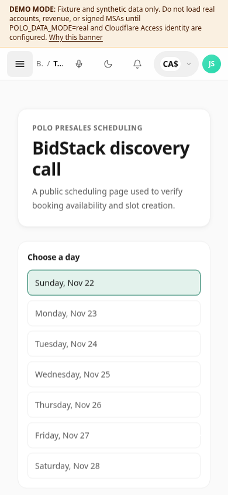
| Pipeline still prints the drag sentence, and it wraps to several lines at 390. Accounts still repeats the portfolio sentence, the tile captions, and the cockpit essay. | #366 |
| Pipeline columns at 1280 are the sliced-board issue. | #361 |
| Account filter row. | #362 |
| CSV import mapping on a phone. | #349 |
| Sweep 05 log and the French/Spanish/Italian key gate. Not this lens. | #399, #406 |
| Sweep 09 empty, large, and edge data. Not this lens. | #456 |

Account timeline marks stay at 28×28. Sweep 05 recorded the axe `target-size` failure and left it, because the pseudo hit area overlaps the neighbours. Not reopened here.

## What held

- The drawer opens from the menu button, traps the page behind it, and closes on Escape. Sections are 44px-class rows.

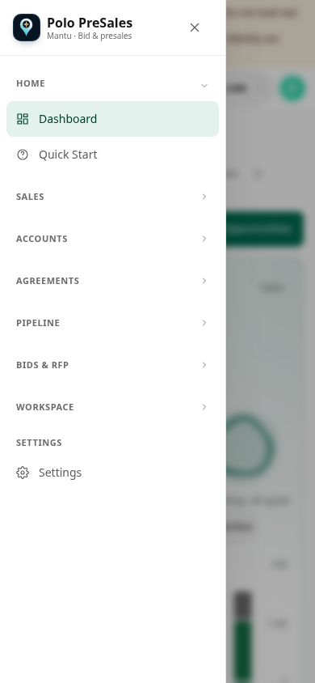

- Companies, contacts, leads, the pipeline board, workload, and the audit log scroll sideways inside their own containers. The page itself does not.
- The dashboard’s first paint is skeleton rows, not an empty flash.
- With `prefers-reduced-motion: reduce`, a navigation from the dashboard to Opportunities produced no CSS transform. `MotionConfig` is `user`, which follows that media query. Page transitions drop the rise and keep a short opacity fade.
- The quick-actions disc is 52px. Chart “…” actions are in the document and use a 44px box.
- No optimistic update failed and rolled back dirty in the surfaces opened here (stage filter, dashboard switcher, widget dialog cancel). A failing mutation was not forced.

A frame-time trace was not recorded, so this log does not claim 60fps.

## Findings

### 1. High — Add widget’s form is under the overlay and scroll is locked

`Dialog.Content` used `asChild`, so `fixed inset-0` and the card’s `relative` landed on the same node. `relative` won. On a 390×844 phone the panel started at y=844. In landscape it started at y=390. The overlay covered the viewport, `data-scroll-locked` was set, and `elementFromPoint` on the title field returned the overlay.

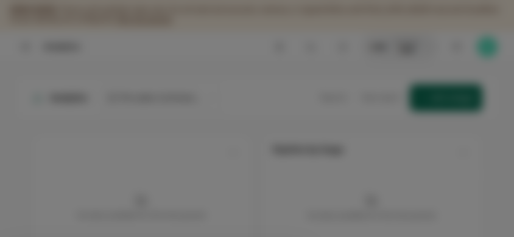

Fixed in draft #468, head `7ce5916995460b0dfb7d4a9902dc3258bea0a06c`. The card is a child of a fixed scroller and is capped to the viewport.

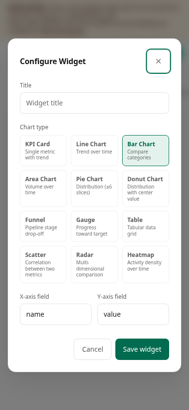

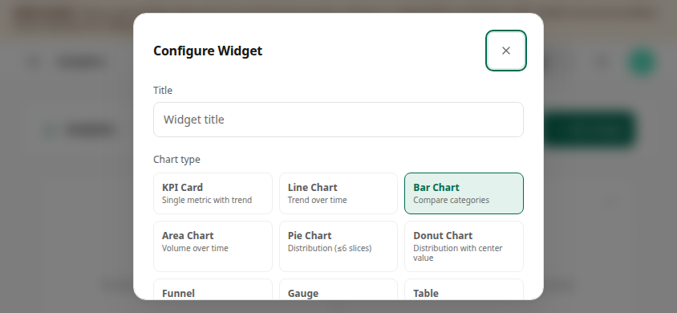

### 2. High — Add widget itself is past the right edge at 390px

The analytics header is one row. At 390px the button’s box was x=472, width=91 (right edge 564). The shell uses `overflow-x: clip`, so it cannot be scrolled into view. “Reports” was cut to “Repor”.

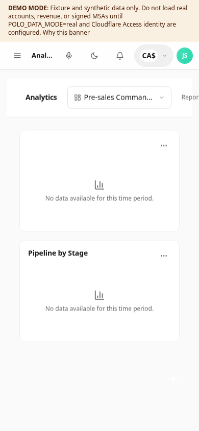

Fixed in draft #469, head `e858c8cb957c4b18cda313fa13f64fc427f2b227`. The actions wrap onto the next line. At 640px and up they stay on the right.

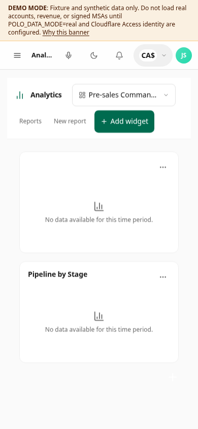

### 3. Medium — Delete dashboard only exists on hover

The control was `hidden` until `group-hover:flex`. The `hover: none` fallback only forces `.group-hover:opacity-100`. On a touch phone the button was absent from the accessibility tree.

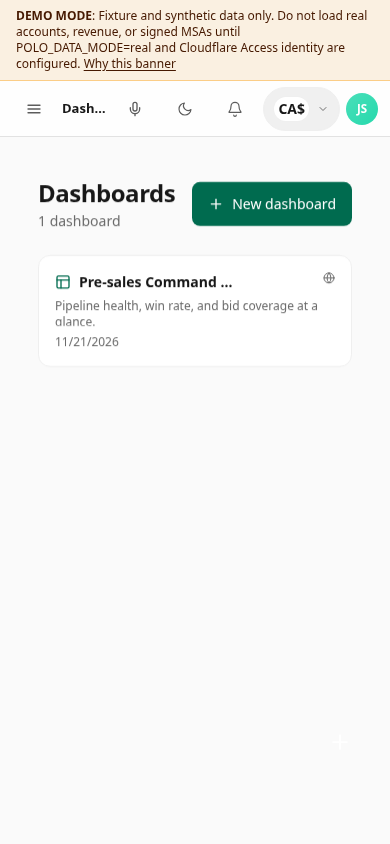

Fixed in draft #470, head `0cf014883e1734644eb32f1b6ecfc668575ccb0d`. The button stays 44×44, opaque on a coarse pointer, hidden until hover or focus on a mouse.

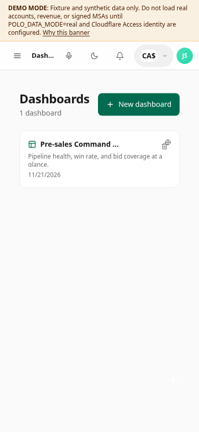

### 4. Medium — the phone bar clips the page name

At 390px the crumb was 45px wide. “Opportunities” overflowed it by 46px, so the bar read “Opp...”.

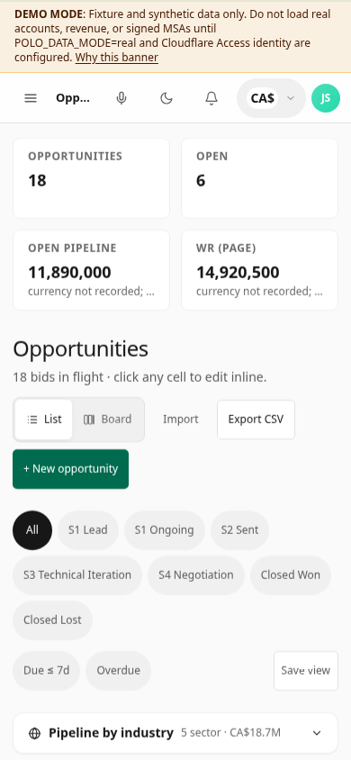

Fixed in draft #471, head `2f285085a78acb75419bbf50d98630f480034d4c`. Below 520px the name has its own row. This does not edit the sign-out rules in #402.

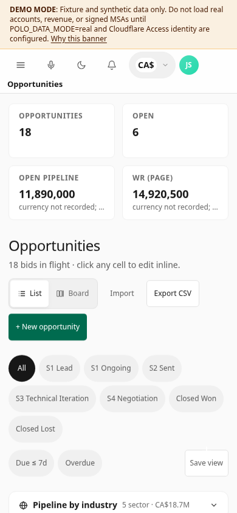

## Fix pull requests

| Class | PR | Head |
| --- | --- | --- |
| Add-widget dialog off screen | https://github.com/mysticalsin/bidstack-360/pull/468 | `7ce5916995460b0dfb7d4a9902dc3258bea0a06c` |
| Add widget clipped at 390 | https://github.com/mysticalsin/bidstack-360/pull/469 | `e858c8cb957c4b18cda313fa13f64fc427f2b227` |
| Delete dashboard hover-only | https://github.com/mysticalsin/bidstack-360/pull/470 | `0cf014883e1734644eb32f1b6ecfc668575ccb0d` |
| Phone bar clips the page name | https://github.com/mysticalsin/bidstack-360/pull/471 | `2f285085a78acb75419bbf50d98630f480034d4c` |

All four are drafts from `main`.
